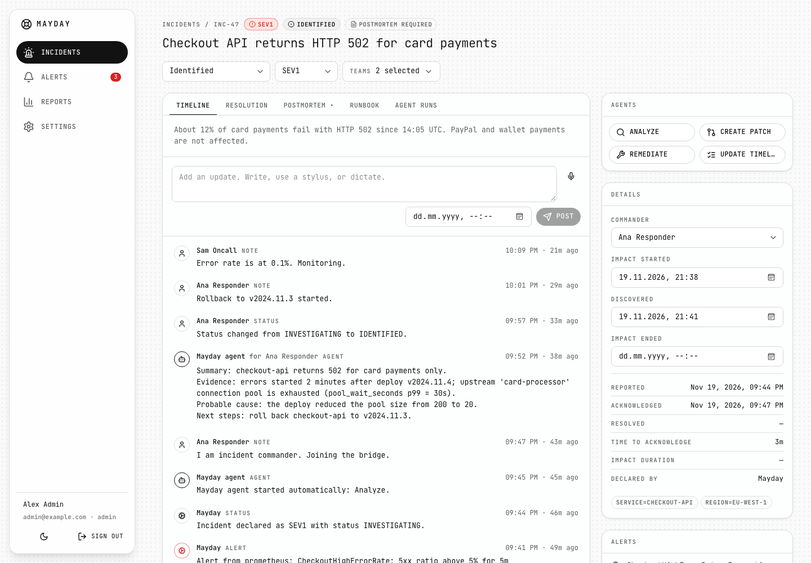
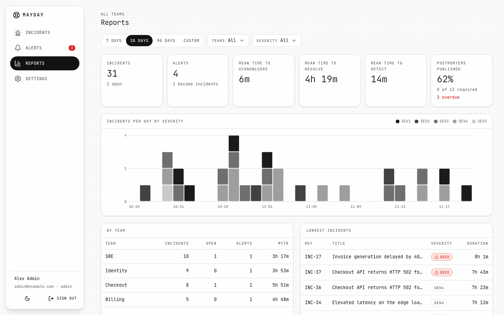

# Mayday! Mayday!

Incidents happen at 03:00. The first 15 minutes go to collecting context: which alert, which deploy, which dashboard, who is on call. Mayday gives that work to agents, so your responders start with findings instead of questions.

Mayday is an AI-first, self-hosted incident management platform.

- **Agents start before you do.** A severe alert opens an incident and an agent analyzes it with your tools (Grafana, GitHub, tickets through MCP). Its findings are on the timeline when you open the page.
- **Agents act as you, never more.** Press "Create patch" and the agent receives a delegated token. It has your permissions, and every change shows the agent's name and yours.
- **Less writing after the incident.** Agents keep the timeline complete, draft the postmortem, and turn your resolution notes (typed, written with a stylus, or dictated) into a runbook in ASD-STE100 Simplified Technical English.
- **Rules that hold.** Administrators set minimums (for example "postmortem mandatory from SEV2") that teams can make stricter but not weaker. Teams can request an exception.
- **Open to any agent.** A built-in MCP server lets Claude, coding agents and your own bots read incidents and, when allowed, write to them.
- **Runs anywhere.** One service. A laptop with no database, a VM, or Kubernetes with PostgreSQL and many replicas.
- **One typed API.** gRPC with a protobuf contract for the web interface, scripts and agents.

## Example: a SEV1 with an agent

1. Prometheus Alertmanager sends `CheckoutHighErrorRate` (critical, team `checkout`) to `/api/v1/integrations/alertmanager`.
2. Mayday opens `INC-47` (SEV1), links the alert and marks the postmortem as mandatory (organization policy).
3. The built-in agent starts automatically. It queries the metrics and deploy history through the tool gateway and posts: *"Errors started 2 minutes after deploy v2024.11.4. The card-processor connection pool is exhausted. Probable cause: pool size reduced from 200 to 20."*
4. Ana, the incident commander, presses **Create patch**. The coding agent receives a signed webhook with a token that acts as Ana, opens a pull request that restores the pool size, and reports the link on the timeline: *"Mayday agent for Ana Responder"*.
5. The team rolls back and sets the status to **Resolved**. Mayday records the resolution time and sets the postmortem due date.
6. Ana dictates how they solved it in **Resolution** and presses **Generate runbook**. She presses **Draft postmortem**, reviews the draft and publishes it.
7. On Friday, the director opens **Reports** for the Payments teams: MTTA, MTTR and postmortem compliance for the quarter.

## Screenshots

| | |
|---|---|
|  |  |
|  |  |

## Install and run

### Try it (Docker)

```bash
docker compose up --build
```

Open http://localhost:8080 and sign in as `admin@example.com` (sample data and email sign-in are on in this setup).

| Port | Serves |
|---|---|
| 8080 | Web interface, gRPC-Web, MCP (`/mcp`), alert webhooks, health and metrics |
| 9090 | Native gRPC (for example `grpcurl -plaintext localhost:9090 list`) |

### Run from source

Needs Java 21+ and Node.js 22+ (or Docker, which the Makefile uses when they are missing). `make demo` builds `build/libs/mayday.jar` and starts it with `java -jar`.

```bash
make demo
```

```bash
make test
```

### Production

1. Set `MAYDAY_SECRET_KEY`, `MAYDAY_PUBLIC_URL`, single sign-on (`MAYDAY_OIDC_ISSUER`, `MAYDAY_OIDC_CLIENT_ID`, `MAYDAY_OIDC_CLIENT_SECRET`) and `MAYDAY_DATABASE_URL`.
2. Deploy with the Helm chart in [deploy/helm/mayday](deploy/helm/mayday) or the Terraform module in [deploy/terraform](deploy/terraform).
3. In **Settings**, add the LLM provider key for the built-in agent, your MCP servers, and external agents.

Details: [docs/deployment.md](docs/deployment.md).

## Connect an agent

```json
{ "mcpServers": { "mayday": { "type": "http", "url": "https://mayday.example.com/mcp", "headers": { "Authorization": "Bearer <token>" } } } }
```

Create the token in **Settings → API tokens**. Write tools need the team setting `mcp.write_enabled`.

## Documentation

[docs/](docs/README.md): architecture, product brief per domain, API (gRPC, HTTP) and webhook contracts, testing, deployment, decisions. API contract: [proto/mayday/v1](proto/mayday/v1).
