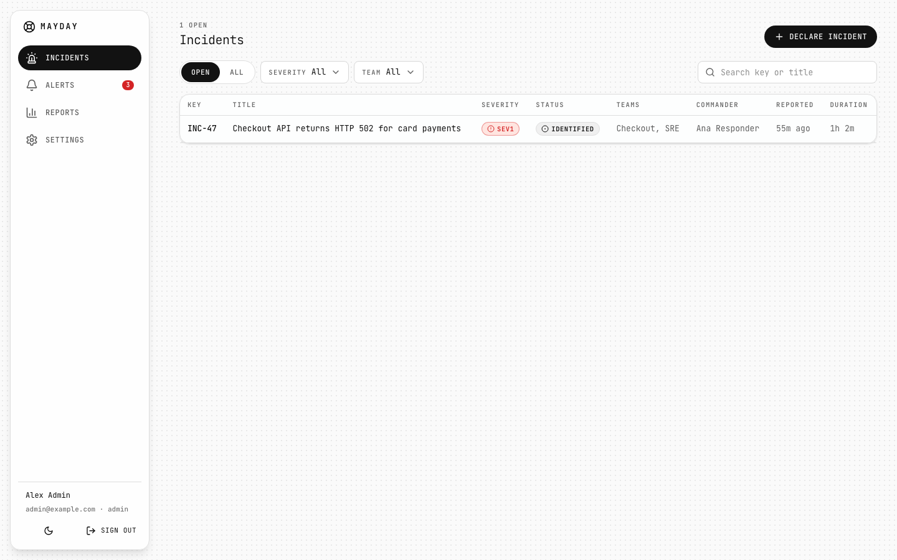
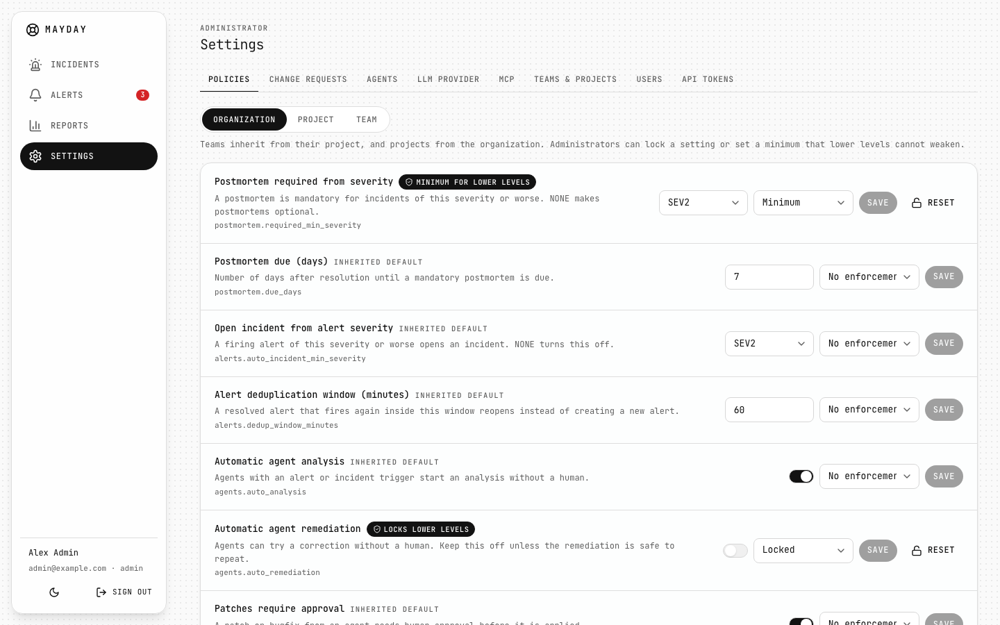
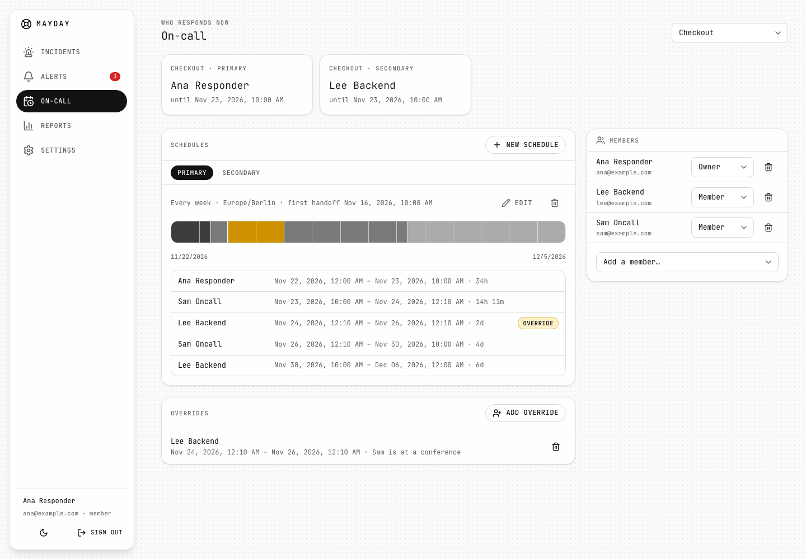
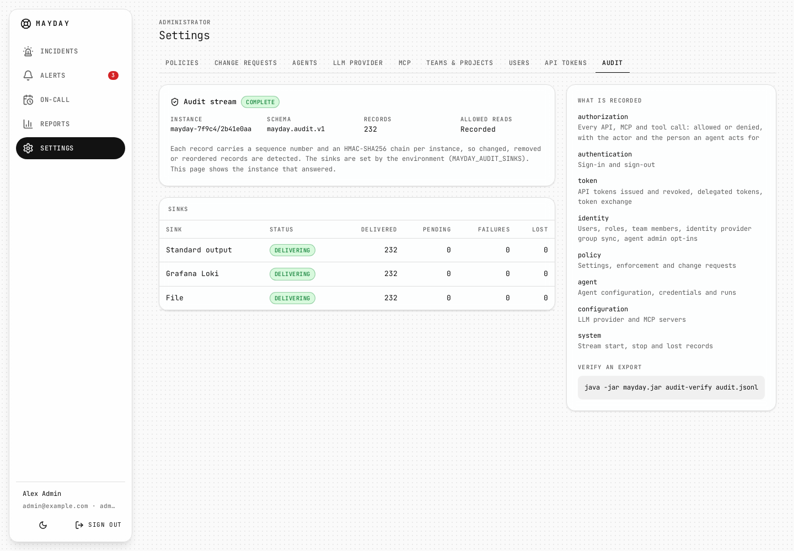
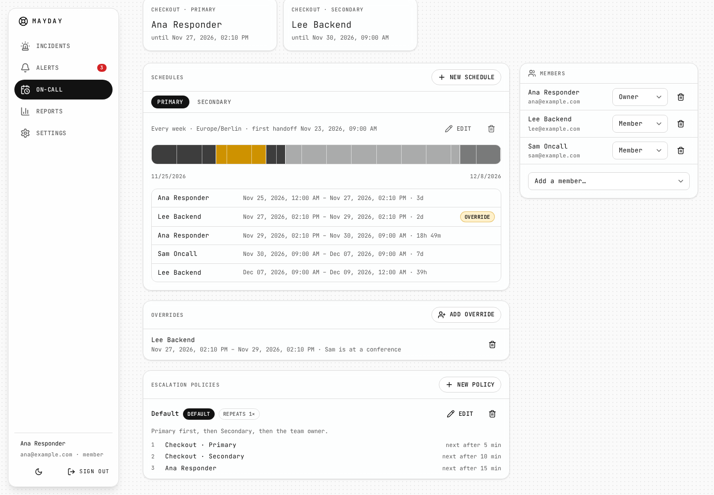
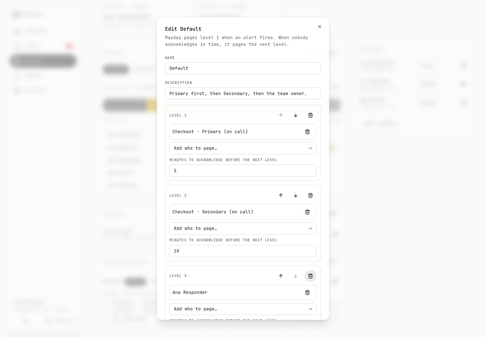
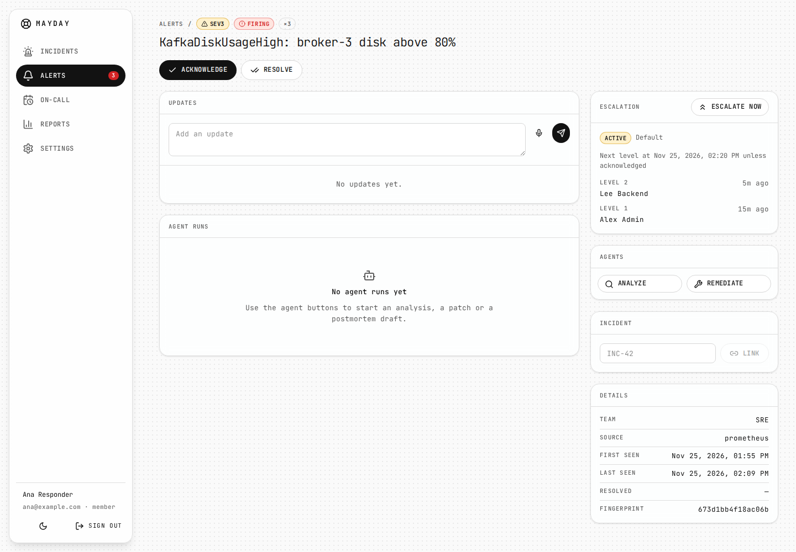
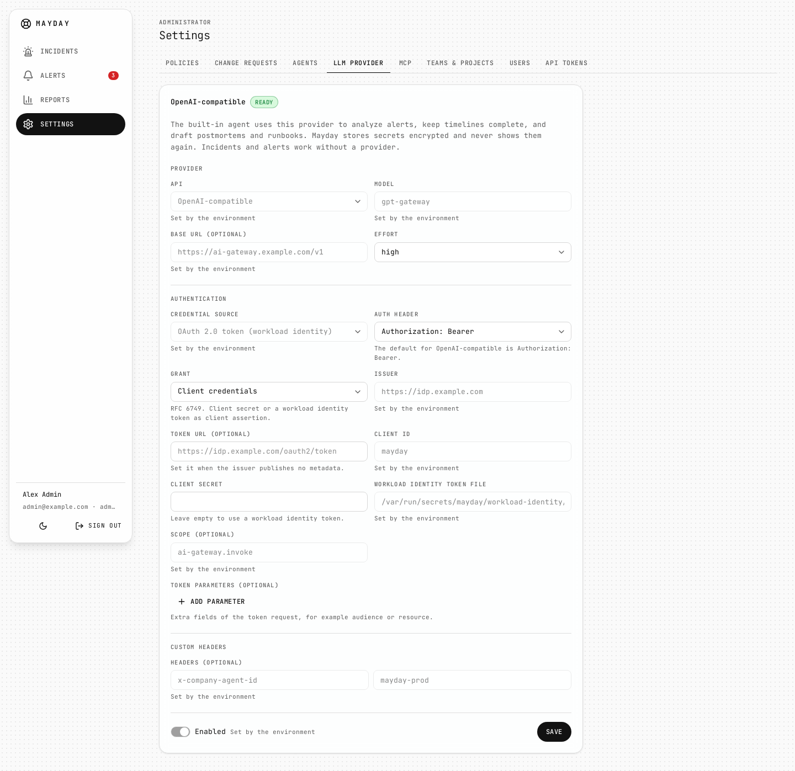
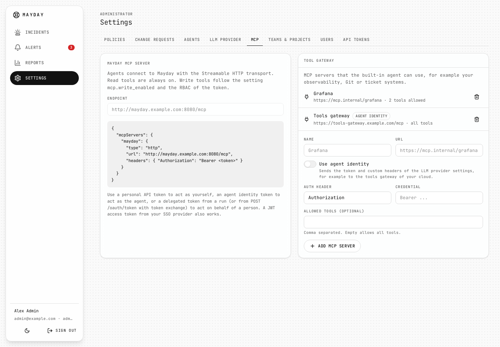

# Mayday! Mayday!

Incidents happen at 03:00. The first 15 minutes go to collecting context: which alert, which deploy, which dashboard, who is on call. Mayday gives that work to agents, so your responders start with findings instead of questions.

Mayday is an AI-first, self-hosted incident management platform.

- **Agents start before you do.** A severe alert opens an incident and an agent analyzes it with your tools (Grafana, GitHub, tickets through MCP). Its findings are on the timeline when you open the page.
- **Agents act as you, never more.** Press "Create patch" and the agent receives a delegated token. It has your permissions, and every change shows the agent's name and yours.
- **An audit trail your SIEM trusts.** Every allowed and refused action, token, policy change and agent call goes to Microsoft Sentinel, Grafana Loki or any collector, with the actor and the person an agent acts for. A hash chain shows changed or missing records. It gives evidence for ISO/IEC 27001 access, logging and monitoring controls.
- **Less writing after the incident.** Agents keep the timeline complete, draft the postmortem, and turn your resolution notes (typed, written with a stylus, or dictated) into a runbook in ASD-STE100 Simplified Technical English.
- **Rules that hold.** Administrators set minimums (for example "postmortem mandatory from SEV2") that teams can make stricter but not weaker. Teams can request an exception.
- **Open to any agent.** A built-in MCP server lets Claude, coding agents and your own bots read incidents and, when allowed, write to them.
- **Fits your AI gateway.** The built-in agent calls any Anthropic or OpenAI-compatible base URL with a short-lived token from any OAuth 2.0 identity provider (workload identity, no stored secret) and your custom headers. Tools come from the MCP tools gateway in your cloud with the same identity. When the gateway says the budget is used up (HTTP 429), the agent pauses for the stated cooldown (15 minutes if none); it never retries in a loop.
- **Agents are optional.** Without an agent, Mayday is a complete incident management tool. Alerts and incidents never wait for an agent.
- **See what the agent did.** Every agent run is an OpenTelemetry trace: each model turn, each tool call, token usage and errors. The run links to it.
- **The right person, without a spreadsheet.** Teams have on-call schedules. When someone is sick, a colleague covers for a set period with one click; team owners can plug in anyone from the team. Agents ask `get_on_call` too.
- **Nobody sleeps through a page.** Escalation policies page the person on call, then the next level when nobody acknowledges in time. Team owners configure them; administrators set the limits for all teams (for example "the next level after 15 minutes at most"). Pages go to your chat, SMS or push service through one signed webhook.
- **Teams stay in your identity provider.** Entra ID, Okta, Keycloak or any OIDC and SCIM 2.0 provider: groups become teams and owners, and people who leave a group leave the team and its rotations. Open standards only.
- **Runs anywhere.** One service. A laptop with no database, a VM, or Kubernetes with PostgreSQL and many replicas.
- **One typed API.** gRPC with a protobuf contract for the web interface, scripts and agents.

## Example: a SEV1 with an agent

1. Prometheus Alertmanager sends `CheckoutHighErrorRate` (critical, team `checkout`) to `/api/v1/integrations/alertmanager`.
2. Mayday opens `INC-47` (SEV1), links the alert and marks the postmortem as mandatory (organization policy). The Checkout escalation policy pages Ana, the Checkout primary this week. She is on the train and does not acknowledge, so after 5 minutes Mayday pages Lee, the secondary. Lee acknowledges and the escalation stops. Later this week Lee covers Sam's shift with an override, because Sam is at a conference.
3. The built-in agent starts automatically. It calls the company AI gateway with its workload identity token, queries the metrics and deploy history through the tools gateway, and posts: *"Errors started 2 minutes after deploy v2024.11.4. The card-processor connection pool is exhausted. Probable cause: pool size reduced from 200 to 20."*
4. Ana, the incident commander, presses **Create patch**. The coding agent receives a signed webhook with a token that acts as Ana, opens a pull request that restores the pool size, and reports the link on the timeline: *"Mayday agent for Ana Responder"*.
5. The team rolls back and sets the status to **Resolved**. Mayday records the resolution time and sets the postmortem due date.
6. Ana dictates how they solved it in **Resolution** and presses **Generate runbook**. She presses **Draft postmortem**, reviews the draft and publishes it.
7. On Friday, the director opens **Reports** for the Payments teams: MTTA, MTTR and postmortem compliance for the quarter.

Each step is in the audit stream: the alert intake, the agent's tool calls *as Ana*, the delegated token, the status change. Security finds them in Sentinel with one query.

If the agent's gateway budget runs out during step 3, the run fails once with "HTTP 429", the agent pauses, and steps 1, 2, 5 and 7 work the same. **View trace** on each run shows what the agent did.

## Screenshots

| | |
|---|---|
|  |  |
|  |  |
|  |  |
|  |  |
|  | |
|  |  |

## Install and run

### Try it (Docker)

```bash
docker compose up --build
```

Open http://localhost:8080 and sign in as `admin@example.com` (sample data and email sign-in are on in this setup).

| Port | Serves |
|---|---|
| 8080 | Web interface, gRPC-Web, MCP (`/mcp`), alert webhooks, health and metrics |
| 9090 | Native gRPC (for example `grpcurl -plaintext localhost:9090 list`) |

### Run from source

Needs Java 21+ and Node.js 22+ (or Docker, which the Makefile uses when they are missing). `make demo` builds `build/libs/mayday.jar` and starts it with `java -jar`.

```bash
make demo
```

`make test` also needs Docker: the contract tests start a disposable PostgreSQL database and a Keycloak identity provider with Testcontainers.

```bash
make test
```

`make e2e` runs the use-case tests in a browser (headless). `make e2e HEADED=1` shows the browser so you can watch each step. See [docs/testing.md](docs/testing.md#use-case-tests).

```bash
make e2e HEADED=1
```

### Production

1. Set `MAYDAY_SECRET_KEY`, `MAYDAY_PUBLIC_URL`, single sign-on (`MAYDAY_OIDC_ISSUER`, `MAYDAY_OIDC_CLIENT_ID`, `MAYDAY_OIDC_CLIENT_SECRET`) and `MAYDAY_DATABASE_URL`.
2. Deploy with the Helm chart in [deploy/helm/mayday](deploy/helm/mayday) or the Terraform module in [deploy/terraform](deploy/terraform).
3. Optional: connect the built-in agent to your AI gateway with `MAYDAY_LLM_*` (base URL, provider, OAuth 2.0 issuer, custom headers) or in **Settings → LLM provider**. Add MCP servers and external agents in **Settings**.
4. Optional: teams from your identity provider. Send a `groups` claim, and point your provider's SCIM app at `<public URL>/scim/v2` with an administrator token that has the SCIM scope. `MAYDAY_GROUPS_AUTO_CREATE=true` and `MAYDAY_GROUPS_FILTER=^oncall-` create teams from groups. Steps for Entra ID: [docs/domains/provisioning.md](docs/domains/provisioning.md).
5. Audit stream: records go to standard output by default. Send them to your SIEM with `MAYDAY_AUDIT_SINKS=sentinel` or `loki` (or `http`, `file`) and the settings in [docs/domains/audit.md](docs/domains/audit.md).
6. Optional: deliver escalation pages to your chat, SMS or push service with `MAYDAY_PAGING_WEBHOOK_URL` (and `MAYDAY_PAGING_WEBHOOK_SECRET` to sign them). Team owners create escalation policies on the **On-call** page. See [docs/domains/escalation.md](docs/domains/escalation.md).
7. Optional: send traces to your collector with `MAYDAY_OTEL_ENDPOINT`. Locally: `MAYDAY_OTEL_ENDPOINT=http://jaeger:4318 docker compose --profile observability up` starts Jaeger on http://localhost:16686.

Details: [docs/deployment.md](docs/deployment.md) (enterprise AI gateway, Kubernetes workload identity, token proxy sidecar) and [docs/observability.md](docs/observability.md).

## Connect an agent

```json
{ "mcpServers": { "mayday": { "type": "http", "url": "https://mayday.example.com/mcp", "headers": { "Authorization": "Bearer <token>" } } } }
```

Create the token in **Settings → API tokens**. Write tools need the team setting `mcp.write_enabled`.

## Documentation

[docs/](docs/README.md): architecture, product brief per domain, API (gRPC, HTTP) and webhook contracts, testing, deployment, decisions. API contract: [proto/mayday/v1](proto/mayday/v1).
