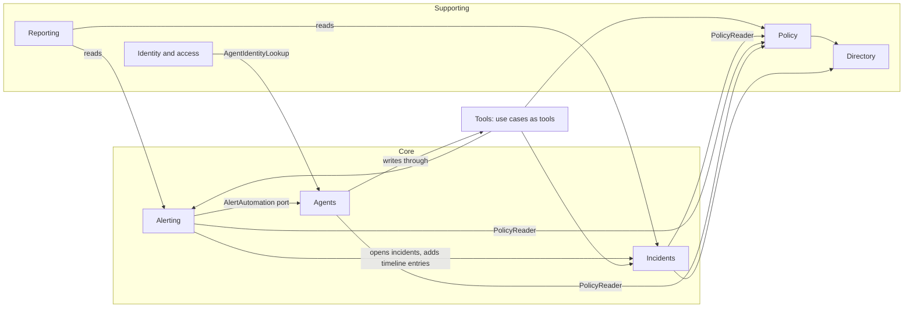
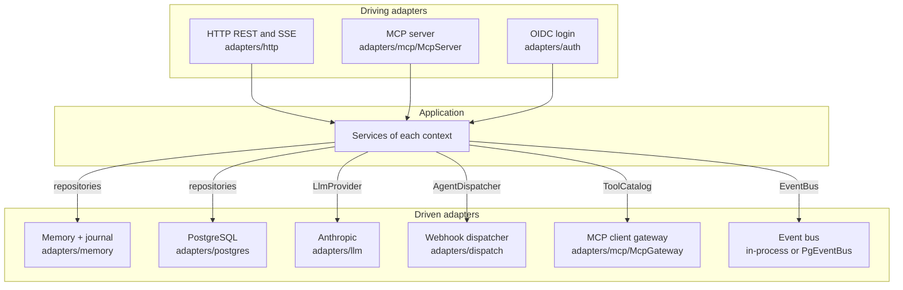
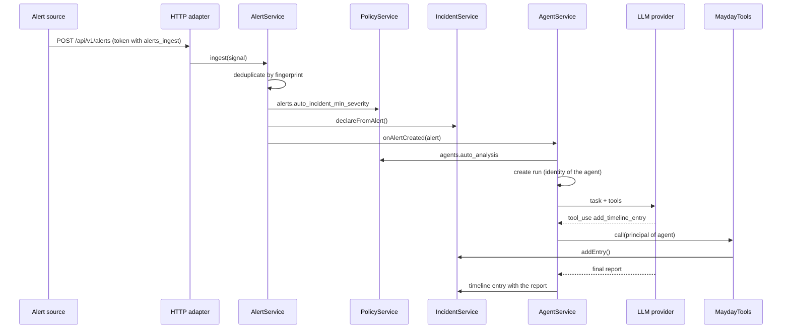
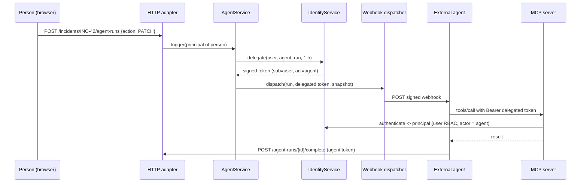

# Architecture

Mayday is one deployable service. It uses domain-driven design (DDD) for the model and hexagonal architecture (ports and adapters) for the boundaries. You can replace each adapter without a change to the domain.

## Principles

- The domain has no framework code. It uses the Kotlin standard library and the JDK only.
- Each bounded context owns its model, its use cases (services) and its ports (interfaces).
- Adapters implement ports: storage, HTTP, MCP, LLM, webhooks, identity provider.
- The composition root (`src/main/kotlin/mayday/Main.kt`) connects the parts. It is the only place that knows all adapters.
- Each port has a contract test suite. Each adapter must pass it (see [testing.md](testing.md)).
- The service is stateless when it uses PostgreSQL. Sessions are signed cookies. Live events use PostgreSQL `LISTEN/NOTIFY`. You can run many replicas.

## Context map

| Context | Package | Responsibility | Brief |
|---|---|---|---|
| Incidents | `mayday.incidents` | Incident aggregate, timeline, postmortem, resolution, runbook | [incidents.md](domains/incidents.md) |
| Alerting | `mayday.alerting` | Alert intake, deduplication, automatic incidents | [alerting.md](domains/alerting.md) |
| Agents | `mayday.agents` | Agent configuration, runs, delegation, built-in agent, tool gateway, LLM port | [agents.md](domains/agents.md) |
| Policy | `mayday.policy` | Scoped settings, enforcement, change requests | [policy.md](domains/policy.md) |
| Identity and access | `mayday.identity` | Users, roles, tokens, principals, on-behalf-of | [identity.md](domains/identity.md) |
| Directory | `mayday.directory` | Projects and teams | [directory.md](domains/directory.md) |
| Reporting | `mayday.reporting` | Metrics over incidents and alerts | [reporting.md](domains/reporting.md) |
| Tools | `mayday.tools` | Use cases as tools for MCP and the built-in agent | [mcp.md](domains/mcp.md) |
| Web interface | `web/` | React and shadcn-style interface | [web.md](domains/web.md) |

## Ports and adapters

| Port | Defined in | Adapters |
|---|---|---|
| `*Repository` (13 ports) | each context | `MemoryStore`, `PostgresStore` |
| `EventBus` | `shared` | `InProcessEventBus`, `PgEventBus` |
| `LlmProvider`, `LlmProviderFactory` | `agents` | `AnthropicProvider`; tests use `FakeLlm` |
| `AgentDispatcher` | `agents` | `WebhookDispatcher`; tests use `RecordingDispatcher` |
| `ToolCatalog` | `agents` | `MaydayTools`, `McpGateway`, `CompositeCatalog` |
| `AgentIdentityLookup` | `identity` | `AgentService` |
| `AlertAutomation` | `alerting` | `AgentService` |
| `PolicyReader` | `policy` | `PolicyService` |

## Key interactions

### An alert fires and an agent analyzes it

### A person starts an agent (on behalf of)

### Live updates across replicas

Each service publishes a `DomainEvent`. `PgEventBus` sends it to local listeners and to `pg_notify`. The other replicas receive it with `LISTEN` and give it to their SSE clients. Each browser holds one `EventSource` connection and reloads only the data that changed.

## Scale

Targets: 50,000 to 100,000 concurrent users, 1,000 to 10,000 incidents and alerts each day.

- The HTTP server uses virtual threads. A blocked request or an SSE connection costs a few kilobytes, not a platform thread.
- SSE clients have a bounded queue (256 events). A slow client loses events, not server memory.
- List queries use keyset pagination (`number` for incidents, `(first_seen_at, id)` for alerts) and indexes.
- Report queries stream rows with a server-side cursor. They do not load all rows into memory.
- Writes use optimistic concurrency (`version`) instead of locks. Pull agents claim runs with `FOR UPDATE SKIP LOCKED`.
- Static assets have content hashes and immutable cache headers. JSON responses above 1 KiB use gzip.
- Settings resolution uses an in-memory cache. A `setting.changed` event clears it on all replicas.

## Security

- Authentication: OIDC with PKCE, JWT validation with JWKS (RS256, ES256), API tokens (stored as SHA-256), delegated tokens (HS256).
- CSRF: cookie sessions need the `X-Requested-With: mayday` header for changes. Cross-site pages cannot send it without CORS.
- Secrets at rest (LLM key, webhook secrets, MCP credentials) use AES-256-GCM with a key from `MAYDAY_SECRET_KEY`.
- Webhooks are signed with HMAC-SHA256 over the timestamp and the body.
- The built-in agent uses the same tools as external agents. RBAC applies to each call.
