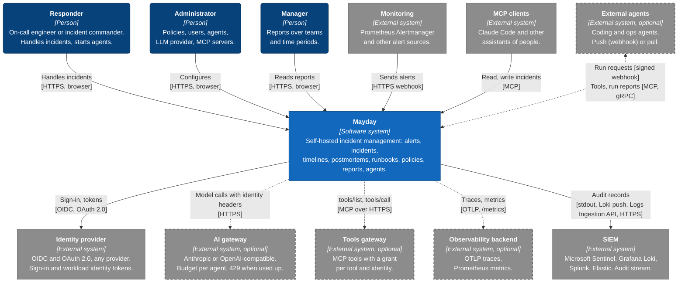
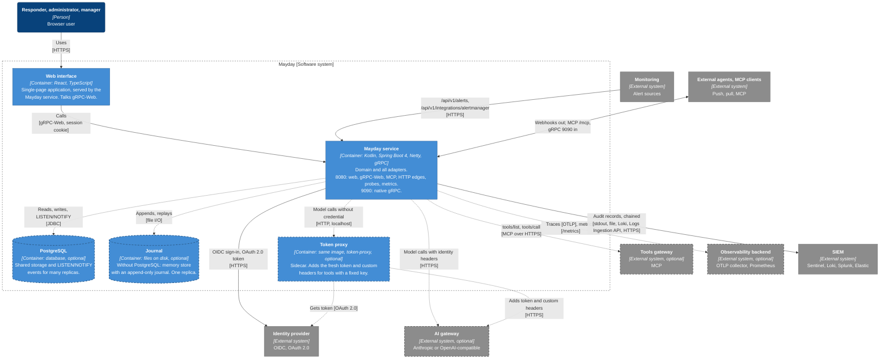
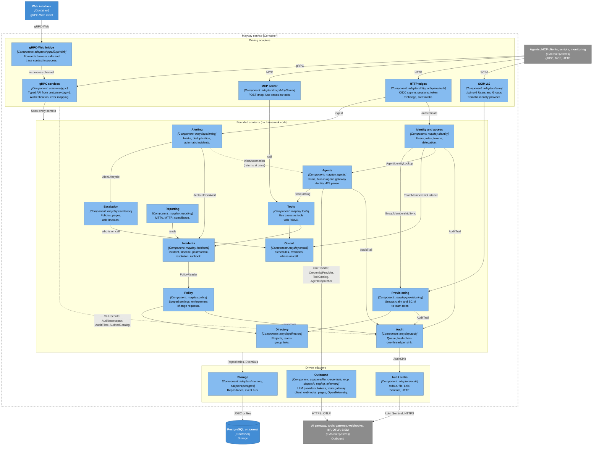
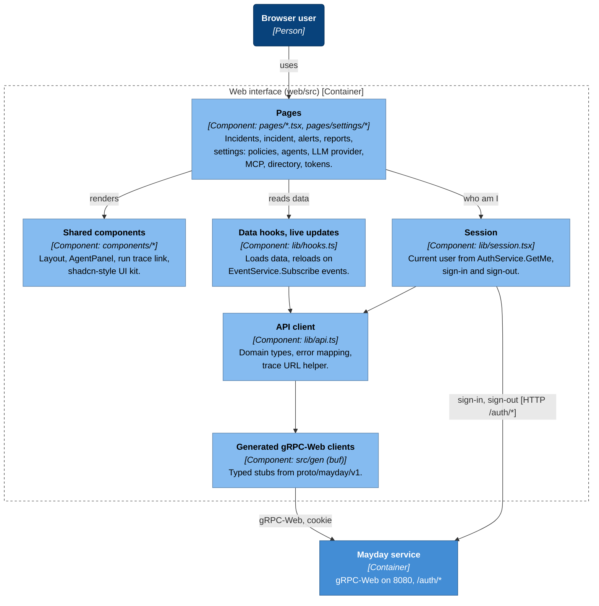
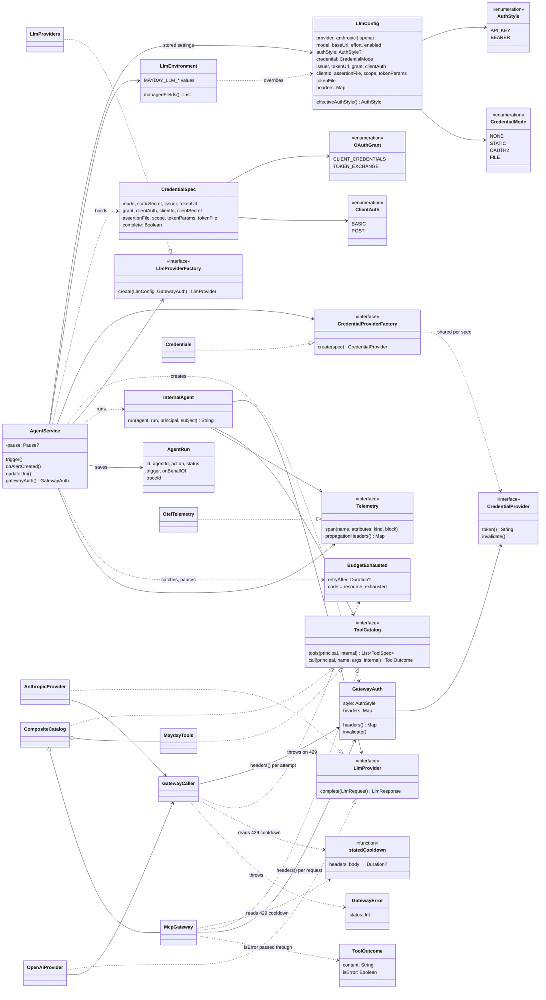
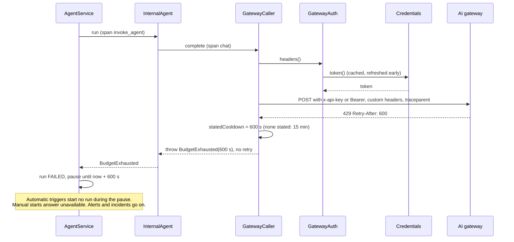
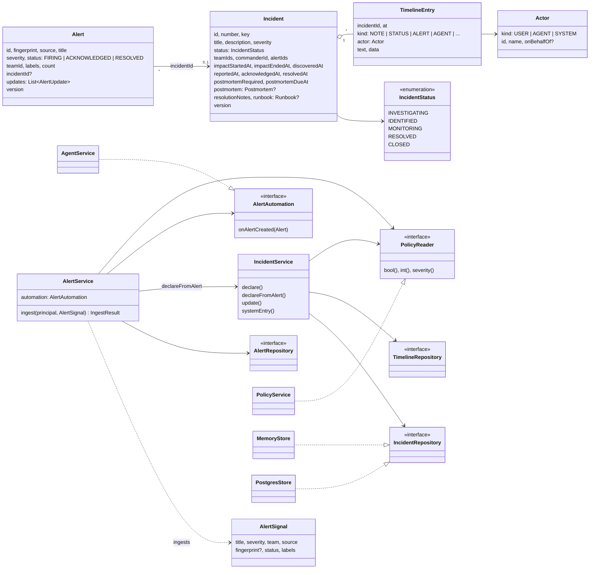

# C4 model

The C4 model shows Mayday at four zoom levels: system context, containers, components and code. Each level zooms into one element of the level above. [architecture.md](architecture.md) gives the rules behind the diagrams.

| Level | Diagram | Question it answers |
|---|---|---|
| 1 | [System context](#level-1-system-context) | Who uses Mayday, and which systems does it talk to? |
| 2 | [Containers](#level-2-containers) | Which deployable and runnable parts does Mayday have? |
| 3 | [Components of the Mayday service](#level-3-components-of-the-mayday-service) | Which adapters and bounded contexts are in the service? |
| 3 | [Components of the agents context](#level-3-components-of-the-agents-context) | How does the built-in agent reach the AI gateway and the tools gateway? |
| 3 | [Components of the web interface](#level-3-components-of-the-web-interface) | How is the browser application built? |
| 4 | [Code: agent gateway](#level-4-code-agent-gateway) | Which types and ports make the gateway identity, 429 handling and tools work? |
| 4 | [Code: incidents and alerting](#level-4-code-incidents-and-alerting) | Which types make the core incident model? |

Notation: dark blue = person, blue = Mayday, mid blue = container, light blue = component, grey = external system. A dashed border or line marks an optional element: Mayday works without an agent, without PostgreSQL and without a tracing backend. Text in square brackets is the element type or the protocol.

## Level 1: System context

| Element | Notes |
|---|---|
| Identity provider | Any OIDC and OAuth 2.0 provider. People sign in with OIDC and PKCE. With workload identity, an authorization server issues the short-lived token for the AI gateway and the tools gateway (client credentials or token exchange; endpoint from the issuer metadata). |
| AI gateway | Optional. Used only by the built-in agent. HTTP 429 means the budget of the agent is used up: Mayday does not retry and pauses the agent for the stated cooldown (15 minutes if none). |
| Tools gateway | Optional. In the customer's cloud. Gets the same token and custom headers as the AI gateway. A refused tool answers `isError: true`. |
| External agents | Optional. A person can start them; they then act on behalf of that person with a delegated token. |
| SIEM | Receives the audit stream: every authorization decision, token event, policy change and agent action, with actor and on-behalf-of. Through stdout and a log agent, a file, the Loki push API, the Azure Monitor Logs Ingestion API or HTTPS. See [audit.md](domains/audit.md). |

## Level 2: Containers

| Container | Runs as | Scale |
|---|---|---|
| Mayday service | One JVM process. Docker image, Helm chart, Terraform module, or `java -jar`. | Stateless with PostgreSQL: run many replicas behind a load balancer. With the journal: one replica. |
| Web interface | Static files inside the jar. Runs in the browser. | Content-hashed assets, cached by the browser and a CDN. |
| PostgreSQL | Managed database or the compose service. | One primary. HikariCP pool per replica (`MAYDAY_DATABASE_POOL`). |
| Token proxy | Sidecar container in the same pod (Helm `tokenProxy.enabled`). | One per pod. Listens on localhost only. |

## Level 3: Components of the Mayday service

Driving adapters call the bounded contexts. The contexts call ports. Driven adapters implement the ports. `App.kt` composes the contexts without a framework; `MaydayApplication.kt` (Spring) chooses the adapters.

The diagram shows the main dependencies only. The full context map and the port table are in [architecture.md](architecture.md#context-map). Every context also uses `EventPublisher`, `Clock` and `Telemetry` from the shared kernel.

## Level 3: Components of the agents context

```mermaid
%%{init: {"flowchart": {"wrappingWidth": 320}}}%%
flowchart LR
  alerting["<b>AlertService</b><br/><i>[Component: mayday.alerting]</i><br/>Calls onAlertCreated"]
  api["<b>gRPC services</b><br/><i>[Component: adapters/grpc]</i><br/>StartRun, ClaimRuns, UpdateLlm"]
  subgraph agents["Agents context and its adapters"]
    direction LR
    svc["<b>AgentService</b><br/><i>[Component: agents/AgentService]</i><br/>Triggers, runs, settings with<br/>environment overrides, 429 pause,<br/>run spans and trace IDs."]
    loop["<b>InternalAgent</b><br/><i>[Component: agents/InternalAgent]</i><br/>Agent loop, at most 24 turns.<br/>Spans invoke_agent, chat, execute_tool."]
    auth["<b>GatewayAuth</b><br/><i>[Component: agents/Gateway]</i><br/>Headers per call: custom headers,<br/>token in x-api-key or Bearer."]
    llm["<b>LlmProviders + GatewayCaller</b><br/><i>[Component: adapters/llm]</i><br/>Anthropic or OpenAI-compatible,<br/>both on java.net.http.<br/>401: refresh once. 429: BudgetExhausted<br/>with the stated cooldown, no retry.<br/>5xx: at most 2 retries."]
    creds["<b>Credentials</b><br/><i>[Component: adapters/credentials]</i><br/>STATIC, OAUTH2 (client credentials or<br/>token exchange, issuer discovery), FILE.<br/>Shared cache, early refresh, single flight."]
    catalog["<b>CompositeCatalog</b><br/><i>[Component: tools]</i><br/>MaydayTools + McpGateway"]
    maydaytools["<b>MaydayTools</b><br/><i>[Component: tools]</i><br/>Incident, alert, policy<br/>use cases with RBAC."]
    gateway["<b>McpGateway + McpClient</b><br/><i>[Component: adapters/mcp]</i><br/>Agent identity or static header.<br/>isError passed through.<br/>429 pauses the server."]
    dispatch["<b>WebhookDispatcher</b><br/><i>[Component: adapters/dispatch]</i><br/>Signed webhook with traceparent."]
    telemetry["<b>OtelTelemetry</b><br/><i>[Component: adapters/telemetry]</i><br/>Telemetry port on OpenTelemetry."]
  end
  aigw["<b>AI gateway</b><br/><i>[External system]</i><br/>Anthropic or OpenAI-compatible"]
  toolsgw["<b>Tools gateway</b><br/><i>[External system]</i><br/>MCP"]
  tokenep["<b>Token endpoint</b><br/><i>[External system]</i><br/>Any OAuth 2.0 authorization server"]
  pushagent["<b>Push agent</b><br/><i>[External system]</i><br/>Webhook endpoint"]
  otel["<b>OTLP backend</b><br/><i>[External system]</i><br/>Traces"]
  alerting -. "onAlertCreated (async)" .-> svc
  api -- "trigger, claim,<br/>complete, updateLlm" --> svc
  svc -- "runs" --> loop
  svc -- "gatewayAuth()" --> auth
  svc -- "AgentDispatcher" --> dispatch
  svc -- "spans" --> telemetry
  loop -- "LlmProvider.complete" --> llm
  loop -- "ToolCatalog.call" --> catalog
  llm -- "headers() per attempt" --> auth
  catalog --> maydaytools
  catalog --> gateway
  gateway -- "headers() per request" --> auth
  auth -- "token()" --> creds
  creds -- "metadata, token request [HTTPS]" --> tokenep
  llm -- "messages or chat/completions [HTTPS]" --> aigw
  gateway -- "tools/list, tools/call [MCP]" --> toolsgw
  dispatch -- "POST run request [HTTPS]" --> pushagent
  telemetry -- "export [OTLP]" --> otel
  classDef person fill:#08427b,stroke:#052e56,color:#fff
  classDef system fill:#1168bd,stroke:#0b4884,color:#fff
  classDef container fill:#438dd5,stroke:#2e6295,color:#fff
  classDef component fill:#85bbf0,stroke:#5d82a8,color:#000
  classDef ext fill:#8c8c8c,stroke:#6b6b6b,color:#fff
  classDef optional stroke-dasharray:6 4,stroke-width:2px
  classDef boundary fill:none,stroke:#444,stroke-dasharray:4 4
  class alerting,api,svc,loop,auth,llm,creds,catalog,maydaytools,gateway,dispatch,telemetry component
  class aigw,toolsgw,tokenep,pushagent,otel ext
  class agents boundary
```

| Rule | Where |
|---|---|
| A 429 from the AI gateway fails the run once and pauses the built-in agent for the cooldown the response states (default 15 minutes). | `statedCooldown`; `GatewayCaller` throws `BudgetExhausted`; `AgentService` pauses. |
| Alert intake never waits for an agent. | `AgentService.onAlertCreated` launches in the agent scope. |
| A 429 from the tools gateway pauses only that server (same cooldown rules) and goes to the model as a tool error. | `McpClient`, `McpGateway` |
| A refused tool grant (`isError: true`) reaches the model unchanged. No error message is ever parsed. | `McpClient`, `McpGateway` |
| Each run is one trace and links to the request that started it. | `AgentService`, `OtelTelemetry` |

## Level 3: Components of the web interface

## Level 4: Code: agent gateway

The types in `mayday.agents` (`Agents.kt`, `Gateway.kt`) and their adapters. Domain types have no framework imports.

### A 429 from the AI gateway

## Level 4: Code: incidents and alerting

The field lists show the important fields only. The complete model is in [incidents.md](domains/incidents.md) and [alerting.md](domains/alerting.md).
