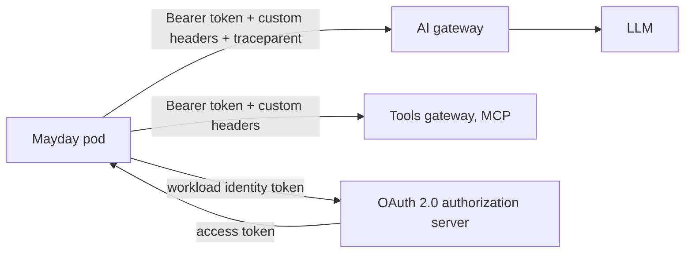

# Deployment

Mayday is one process: a Spring Boot jar (`build/libs/mayday.jar`). It needs Java 21 or later (the container image includes Java 25). PostgreSQL is optional.

| Port | Default | Serves |
|---|---|---|
| HTTP | 8080 | Web interface, gRPC-Web, MCP (`/mcp`), alert intake and webhooks, sign-in, probes, `/metrics` |
| gRPC | 9090 | Native gRPC (h2c), reflection, gRPC health. Optional: open it only for clients that use native gRPC. |

| Mode | Storage | Replicas | Use |
|---|---|---|---|
| Memory | RAM only (`MAYDAY_DATA_DIR=none`) | 1 | Demos and tests |
| Journal | RAM + append-only file in `MAYDAY_DATA_DIR` | 1 | Small teams, bare metal, a single VM |
| PostgreSQL | `MAYDAY_DATABASE_URL` | 1 to many | Production and large organizations |

## Configuration

| Variable | Default | Meaning |
|---|---|---|
| `PORT` / `MAYDAY_PORT` | 8080 | HTTP port |
| `MAYDAY_HOST` | `0.0.0.0` | HTTP bind address |
| `MAYDAY_GRPC_PORT` | 9090 | Native gRPC port |
| `MAYDAY_PUBLIC_URL` | `http://localhost:<port>` | External URL (OIDC callback, links for agents). With `https`, cookies are `Secure`. |
| `MAYDAY_SECRET_KEY` | development key | Signs sessions and delegated tokens, encrypts stored secrets. Use 32+ random characters. Keep it stable. |
| `MAYDAY_DATA_DIR` | `./data` | Journal directory. `none` = memory only. |
| `MAYDAY_DATABASE_URL` | – | `postgresql://host:5432/db` or a JDBC URL |
| `MAYDAY_DATABASE_USER`, `MAYDAY_DATABASE_PASSWORD`, `MAYDAY_DATABASE_POOL` | –, –, 20 | Database access |
| `MAYDAY_OIDC_ISSUER`, `MAYDAY_OIDC_CLIENT_ID`, `MAYDAY_OIDC_CLIENT_SECRET` | – | Single sign-on. Redirect URI: `<public URL>/auth/callback` |
| `MAYDAY_OIDC_SCOPES` | `openid email profile` | Requested scopes |
| `MAYDAY_OIDC_AUDIENCES` | – | Extra audiences accepted on SSO access tokens (on-behalf-of) |
| `MAYDAY_OIDC_GROUPS_CLAIM` | `groups` | Claim with the groups of the person. Dotted path for nested claims (`realm_access.roles`). Blank = no group sync from sign-in |
| `MAYDAY_GROUPS_AUTO_CREATE` | false | Groups that no team links to create teams |
| `MAYDAY_GROUPS_FILTER` | – | Regular expression; only matching groups create teams (for example `^oncall-`) |
| `MAYDAY_GROUPS_OWNER_SUFFIX` | – | Group `<name><suffix>` is the owner group of the team of group `<name>` (for example `-owners`) |
| `MAYDAY_ADMIN_EMAILS` | – | These users become administrators at first login. The first user is always an administrator. |
| `ANTHROPIC_API_KEY` | – | Fallback for `MAYDAY_LLM_API_KEY` |
| `MAYDAY_DEV_LOGIN` | false | Email sign-in without a password. Never in production. |
| `MAYDAY_DEMO` | false | Sample data when the store is empty |
| `MAYDAY_SESSION_HOURS` | 12 | Session lifetime |
| `MAYDAY_MAX_LIVE_CONNECTIONS` | 100000 | Live event streams (`EventService.Subscribe`) per instance |
| `MAYDAY_AGENT_CONCURRENCY` | 16 | Parallel built-in agent runs per instance |
| `MAYDAY_PAGING_WEBHOOK_URL` | – | Escalation pages as signed JSON to a chat bridge, SMS gateway or push service. Empty: pages show only in Mayday and on the event stream. See [api.md](api.md#page-webhook) |
| `MAYDAY_PAGING_WEBHOOK_SECRET`, `MAYDAY_PAGING_WEBHOOK_HEADERS` | – | HMAC secret of `X-Mayday-Signature`; extra headers `name=value,name2=value2` |
| `MAYDAY_WEB_DIR` | – | Serve the interface from a directory instead of the built-in copy |

### Built-in agent (LLM provider)

A set variable overrides the value in Settings → Agents → LLM provider. The interface shows it read-only with the hint "Set by the environment". An empty variable leaves the value to the interface.

| Variable | Meaning |
|---|---|
| `MAYDAY_LLM_PROVIDER` | `anthropic` or `openai` (OpenAI-compatible API) |
| `MAYDAY_LLM_BASE_URL` | Provider or AI gateway URL, for example `https://ai-gateway.example.com/v1` |
| `MAYDAY_LLM_MODEL` | Model name |
| `MAYDAY_LLM_EFFORT` | `low`, `medium`, `high`, `xhigh` or `max` |
| `MAYDAY_LLM_ENABLED` | `true` or `false` |
| `MAYDAY_LLM_AUTH_STYLE` | `api_key` (header `x-api-key`) or `bearer` (`Authorization: Bearer`). The default follows the provider. |
| `MAYDAY_LLM_CREDENTIAL` | `none`, `static`, `oauth2` or `file` |
| `MAYDAY_LLM_API_KEY` | API key for `static`. Fallback: `ANTHROPIC_API_KEY`. |
| `MAYDAY_LLM_ISSUER` or `MAYDAY_LLM_TOKEN_URL` | `oauth2`: the issuer (Mayday reads the token endpoint from its metadata) or the token endpoint |
| `MAYDAY_LLM_GRANT` | `oauth2`: `client_credentials` (default) or `token_exchange` |
| `MAYDAY_LLM_CLIENT_ID`, `MAYDAY_LLM_CLIENT_SECRET`, `MAYDAY_LLM_CLIENT_AUTH` | `oauth2`: client, secret, and `basic` (default) or `post` for the secret |
| `MAYDAY_LLM_ASSERTION_FILE` | `oauth2`: workload identity token file (client assertion, or subject token for `token_exchange`) |
| `MAYDAY_LLM_SCOPE`, `MAYDAY_LLM_TOKEN_PARAMS` | `oauth2`: scope, and extra token request fields such as `audience=...,resource=...` |
| `MAYDAY_LLM_TOKEN_FILE` | Token for `file`. Another process writes and refreshes it. |
| `MAYDAY_LLM_HEADERS` | Custom headers on each gateway call: `name=value,name2=value2`, for example `x-company-agent-id=mayday-prod` |

Mayday uses standard OAuth 2.0 only and works with any compliant authorization server. Details: [domains/gateway-identity.md](domains/gateway-identity.md).

### Audit stream

Every authorization decision, token event, policy change and agent action, for your SIEM. Details, Sentinel table, queries and ISO/IEC 27001 mapping: [audit.md](domains/audit.md).

| Variable | Default | Meaning |
|---|---|---|
| `MAYDAY_AUDIT_SINKS` | `stdout` | Comma separated: `stdout`, `file`, `http`, `loki`, `sentinel`, or `none` |
| `MAYDAY_AUDIT_READS` | true | Record allowed reads. Refusals are always recorded. |
| `MAYDAY_AUDIT_KEY` | derived from `MAYDAY_SECRET_KEY` | HMAC key of the hash chain. Give it to auditors for `audit-verify`. |
| `MAYDAY_AUDIT_INSTANCE` | host name + boot id | Name of the chain of this process |
| `MAYDAY_AUDIT_CAPACITY` | 65536 | Records that wait for the writer. When full, new records are dropped and reported as `audit.dropped`. |
| `MAYDAY_AUDIT_FILE` | – | `file`: path of the JSON lines file |
| `MAYDAY_AUDIT_HTTP_URL`, `MAYDAY_AUDIT_HTTP_HEADERS`, `MAYDAY_AUDIT_HTTP_FORMAT` | –, –, `json` | `http`: collector URL, headers (`name=value,...`), `json` or `ndjson` |
| `MAYDAY_AUDIT_LOKI_URL`, `MAYDAY_AUDIT_LOKI_TENANT` | – | `loki`: base URL (or full push URL) and `X-Scope-OrgID` |
| `MAYDAY_AUDIT_LOKI_USER`, `MAYDAY_AUDIT_LOKI_PASSWORD`, `MAYDAY_AUDIT_LOKI_TOKEN`, `MAYDAY_AUDIT_LOKI_LABELS` | – | `loki`: basic auth or bearer token, extra labels (`env=prod,...`) |
| `MAYDAY_AUDIT_SENTINEL_ENDPOINT`, `MAYDAY_AUDIT_SENTINEL_DCR_ID`, `MAYDAY_AUDIT_SENTINEL_STREAM` | –, –, `Custom-MaydayAudit_CL` | `sentinel`: data collection endpoint, rule immutable id, stream |
| `MAYDAY_AUDIT_SENTINEL_TENANT_ID`, `MAYDAY_AUDIT_SENTINEL_CLIENT_ID` | – | `sentinel`: Microsoft Entra tenant and application |
| `MAYDAY_AUDIT_SENTINEL_CLIENT_SECRET` or `MAYDAY_AUDIT_SENTINEL_ASSERTION_FILE` | –, `AZURE_FEDERATED_TOKEN_FILE` | `sentinel`: client secret, or the workload identity token file |

Helm: `audit.*` in `values.yaml` (secrets go to the chart secret). Terraform: `audit_*` variables.

Verify an export (exit code 0 = intact):

```bash
MAYDAY_AUDIT_KEY=... java -jar mayday.jar audit-verify audit.jsonl
```

### Token proxy and tracing

| Variable | Meaning |
|---|---|
| `MAYDAY_PROXY_UPSTREAM` | Token proxy only: the AI gateway URL |
| `MAYDAY_PROXY_LISTEN` | Token proxy only: listen address, for example `127.0.0.1:8091` |
| `MAYDAY_OTEL_ENDPOINT` | OTLP/HTTP endpoint, for example `http://otel-collector:4318`. Empty: tracing is off. |
| `MAYDAY_OTEL_SAMPLING` | Ratio of traces to keep, `0.0` to `1.0` |
| `MAYDAY_OTEL_CAPTURE_CONTENT` | `true` exports prompts, responses and tool arguments. They can contain incident data. Default `false`. |
| `MAYDAY_TRACE_URL_TEMPLATE` | Link from a run to its trace, for example `https://grafana.example.com/explore?traceId={traceId}`. Without it, the interface shows the trace ID for copying. |

Spring Boot reads all other `spring.*` and `server.*` properties from the environment too, for example `spring.grpc.server.ssl.*` (as `SPRING_GRPC_SERVER_SSL_*`) for TLS on the gRPC port. The defaults are in `src/main/resources/application.yaml`.

## Probes and metrics

| Path (port 8080) | Use |
|---|---|
| `/livez` | Liveness probe |
| `/readyz` | Readiness probe. The container health check uses it. |
| `/healthz` | Overall health |
| `/metrics` | Prometheus text format |
| `grpc.health.v1.Health/Check` (port 9090) | gRPC health for gRPC load balancers |

Important metrics: `http_server_requests_seconds` (HTTP and gRPC-Web), `grpc_server_*` (native gRPC and gRPC-Web calls), `mayday_live_connections` (open event streams), `mayday_audit_accepted`, `mayday_audit_dropped`, `mayday_audit_sink_delivered`, `_failures`, `_dropped`, `_pending` (tag `sink`), `hikaricp_connections_*` (database pool), `jvm_*`. Alert when an audit `dropped` metric is above 0.

## On your machine

With Java 21+ and Node.js 22+ (`make build` runs `npm run build` in `web/` and `./gradlew bootJar`):

```bash
make demo
```

With Docker only:

```bash
docker compose up --build
```

Both open http://localhost:8080 with sample data and email sign-in.

To see the traces of agent runs, start Jaeger with the `observability` profile:

```bash
MAYDAY_OTEL_ENDPOINT=http://jaeger:4318 docker compose --profile observability up --build
```

Jaeger shows the traces on http://localhost:16686. A run in the interface links to its trace.

## Container

```bash
docker build -t mayday .
```

```bash
docker run -p 8080:8080 -p 9090:9090 -v mayday-data:/data -e MAYDAY_SECRET_KEY=$(openssl rand -hex 32) -e MAYDAY_DEV_LOGIN=true mayday
```

The image runs `java -XX:+UseZGC -XX:MaxRAMPercentage=75 -jar /opt/mayday/mayday.jar` as user 10001. It exposes ports 8080 and 9090 and has a health check on `/readyz`.

## Kubernetes (Helm)

```bash
helm install mayday deploy/helm/mayday --set secretKey=$(openssl rand -hex 32) --set publicUrl=https://mayday.example.com --set database.url=postgresql://db:5432/mayday --set database.user=mayday --set database.password=... --set ingress.enabled=true --set ingress.host=mayday.example.com
```

- With `database.url`, the chart runs two or more replicas, a PodDisruptionBudget and (optional) a HorizontalPodAutoscaler.
- Without it, the chart forces one replica and the `Recreate` strategy. Set `persistence.enabled=true` to keep the journal.
- The pod has the ports `http` (8080) and `grpc` (9090). Probes: `/livez` and `/readyz`.
- The service has port `http` (`service.port`, 80) and, with `grpc.enabled` (default), port `grpc` (`service.grpcPort`, 9090, `appProtocol: kubernetes.io/h2c`).
- The ingress (`ingress.*`) serves the web interface, gRPC-Web, MCP and webhooks. It turns off proxy buffering for the live event stream.
- Native gRPC through an ingress: set `grpc.ingress.enabled=true`, `grpc.ingress.host` and `grpc.ingress.tls`. The default annotation is for ingress-nginx (`backend-protocol: GRPC`). Clients need TLS, because the ingress accepts HTTP/2 only with TLS.
- `llm.*` sets the `MAYDAY_LLM_*` variables. `llm.apiKeySecret` and `llm.clientSecretSecret` refer to existing secrets.
- `workloadIdentity.*`, `serviceAccount.*`, `podLabels`, `podAnnotations`, `tokenProxy.*`, `otel.*` and `traceUrlTemplate`: see [Enterprise AI gateway](#enterprise-ai-gateway).

## Terraform

`deploy/terraform` installs the chart on any Kubernetes cluster, creates the namespace, a random secret key and the secrets. `grpc_enabled` (default true) adds the gRPC service port. `grpc_ingress_host` adds a gRPC ingress with the TLS secret `ingress_tls_secret`.

```bash
cd deploy/terraform && terraform init && terraform apply -var-file=example.tfvars
```

Use your cloud's managed PostgreSQL (RDS, Cloud SQL, Azure Database) and pass its URL in `database_url`.

The `llm_*`, `workload_identity_audience`, `service_account_annotations`, `pod_labels`, `token_proxy_upstream`, `otel_*` and `trace_url_template` variables set the matching chart values. Terraform keeps `llm_api_key` and `llm_client_secret` in the `mayday` secret. `example.tfvars` has an example.

## Enterprise AI gateway

Many organizations send all LLM traffic through an AI gateway (an API gateway or an internal proxy). The gateway identifies the caller, checks its budget and keeps an audit log. Tools come from a tools gateway in the same cloud. Mayday supports this setup:

- OpenAI-compatible or Anthropic API at a custom `MAYDAY_LLM_BASE_URL`.
- Short-lived tokens from any OAuth 2.0 authorization server: client credentials with a secret or a workload identity token, token exchange, or a token file. Mayday finds the token endpoint from the issuer, caches the token and gets a new one before it expires.
- Custom headers on each LLM call, for example an agent registry id. MCP servers with "Use agent identity" get the same token and headers.
- W3C trace context on each call. With `MAYDAY_OTEL_ENDPOINT`, each run has a trace that the gateway can join.



### Kubernetes workload identity

1. In your identity provider, trust the cluster's OIDC issuer and allow the service account `system:serviceaccount:<namespace>:<service account>` to get tokens for the gateway.
2. Install the chart:

```yaml
workloadIdentity:
  enabled: true
  audience: https://idp.example.com   # the audience your identity provider expects
llm:
  provider: openai
  baseUrl: https://ai-gateway.example.com/v1
  model: gpt-gateway
  enabled: true
  issuer: https://idp.example.com
  clientId: mayday
  scope: ai-gateway.invoke
  headers:
    x-company-agent-id: mayday-prod   # only if your gateway needs it
```

The chart projects a service account token with that audience to `/var/run/secrets/mayday/workload-identity/token`. With `workloadIdentity.enabled`, `llm.credential` is `oauth2` and `llm.assertionFile` is that path by default.

- Identity provider that exchanges the platform token (RFC 8693): set `llm.grant: token_exchange` and, if needed, `llm.tokenParams: { audience: ... }`.
- Cloud whose webhook writes the token file: set `serviceAccount.create`, `serviceAccount.annotations` and `podLabels` as the webhook needs, leave `workloadIdentity.enabled` off, and set `llm.credential: oauth2` and `llm.assertionFile` to the file the webhook writes.

### Token proxy sidecar

Use the sidecar when a central team owns the gateway credentials, or when other tools in the pod use the same gateway. Set `tokenProxy.enabled=true` and `tokenProxy.upstream`. The chart then:

- Starts a second container from the same image with the argument `token-proxy`, `MAYDAY_PROXY_UPSTREAM` and `MAYDAY_PROXY_LISTEN=127.0.0.1:<tokenProxy.port>`.
- Gives the `llm.*` credential and identity settings to the sidecar, not to Mayday.
- Sets `MAYDAY_LLM_BASE_URL=http://127.0.0.1:<port>` and `MAYDAY_LLM_CREDENTIAL=none` for Mayday.

The sidecar adds the token and the custom headers to each request. MCP servers with "Use agent identity" get no token from Mayday in this mode. Send them through the sidecar too, or give them a static credential.

### Budget used up (HTTP 429)

- Mayday does not retry a call that got HTTP 429.
- The run fails with a clear message. The internal agent pauses for the cooldown that the response states (`Retry-After`, `retry-after-ms`, RateLimit headers, provider reset headers or a `retry_after` JSON field). Without one, it pauses for 15 minutes. The LLM settings page shows the pause in yellow.
- A 429 from an MCP server pauses only that server, with the same cooldown rules.
- Manual runs of the built-in agent fail with `UNAVAILABLE` while the agent is paused. External agents continue to work.
- Saving the LLM settings ends the pause.
- Alert intake and incidents never wait for an agent. A paused agent does not change them.

## Run without an agent

Mayday works fully without an LLM provider and without external agents:

- Incidents, alerts, timelines, postmortems, runbooks, reports and policies work as usual. People write the content.
- The agent buttons on an incident or alert open a dialog that tells you how to configure an agent. Nothing fails.
- Settings → Agents shows that the built-in agent needs an LLM provider.
- Do not set `MAYDAY_LLM_*`. Leave `MAYDAY_OTEL_ENDPOINT` empty if you do not collect traces.

You can add an LLM provider or an external agent at any time. A restart is not necessary.

## Bare metal

Run `java -XX:+UseZGC -jar mayday.jar` with systemd, set the variables in an environment file, and put a TLS reverse proxy in front. Turn off response buffering for gRPC-Web (`/mayday.v1.*`), because `EventService.Subscribe` is a long stream. For native gRPC, the proxy must forward HTTP/2 to port 9090 (h2c).

## Sizing

For 50,000 to 100,000 concurrent users, start with 3 to 6 replicas of 2 CPU and 2 GiB, PostgreSQL with 4 CPU and 16 GiB, and `MAYDAY_DATABASE_POOL=30` per replica. Each idle live connection uses about 10 KiB. Scale on CPU. Watch `http_server_requests_seconds`, `grpc_server_*` and `mayday_live_connections` on `/metrics`.

## Back up and restore

- PostgreSQL: use your normal database backups.
- Journal: copy `MAYDAY_DATA_DIR/mayday.journal` while the service runs. It is append-only and compacted at start.
