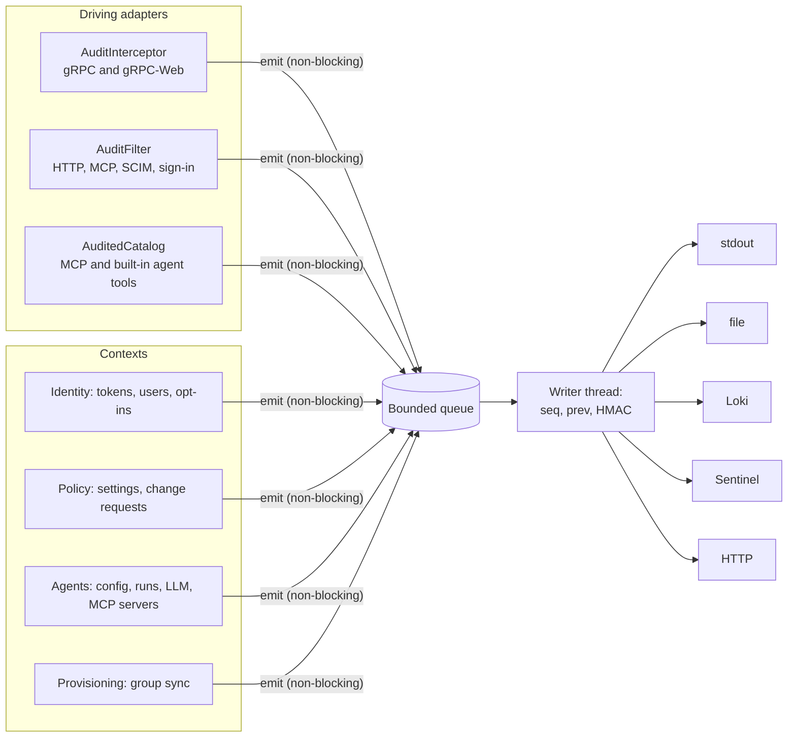

# Audit

Package: `mayday.audit`. Files: `Audit.kt`, `AuditLog.kt`, `AuditVerify.kt`. Adapters: `adapters/audit` (sinks), `adapters/grpc/AuditInterceptors.kt`, `adapters/http/AuditFilter.kt`, `tools/AuditedCatalog.kt`.

## Purpose

Agents act on behalf of people. The organization must be able to prove who did what, as whom, from where, and what Mayday allowed or refused. The audit stream records every authorization decision, every token event, every policy change and every agent action, for people and for agents, and sends it to the SIEM of the organization (Microsoft Sentinel, Grafana Loki, Splunk, Elastic, any HTTP collector). The incident timeline stays the story of one incident; the audit stream is the evidence for the whole system.

## Model

| Element | Rules |
|---|---|
| `AuditEntry` | What a context reports: category, action, actor (`AuditActor`), outcome, target, teams, details, reason, source. An allowed read has `read = true`. |
| `AuditActor` | `actor` (user, agent, system or anonymous party: type, id, name, email), `onBehalfOf` (the person an agent acts for), `role`, `scopes`, `runId`, `credential` (`session`, `api_token`, `delegated_token`, `sso_token`). |
| `AuditRecord` | One JSON line, schema `mayday.audit.v1`. The entry plus `id`, `time` (UTC, ISO 8601), `instance`, `seq`, `traceId`, `prev` and `hash`. Fields are only added, never renamed. Null fields are left out. |
| Instance | Host (pod) name and a boot id. Each process start begins a new chain at `seq` 1. |
| Chain | `hash` = HMAC-SHA256 over the record without `hash`, with the audit key. `prev` = `hash` of the record before it on the same instance. A changed, removed, inserted or forged record breaks the chain. |
| Audit key | `MAYDAY_AUDIT_KEY`, else derived from `MAYDAY_SECRET_KEY` (HMAC with the label `mayday-audit-v1`). Give auditors a separate `MAYDAY_AUDIT_KEY` so they can verify without the main secret. |
| `AuditContext` | Coroutine context element that driving adapters set: the source (channel, IP, `X-Forwarded-For`, user agent). The authenticator writes the resolved caller into it, so a refused request still names its caller. |



## Flow

1. A driving adapter puts an `AuditContext` with the source into the coroutine of the request.
2. The authenticator sets the caller (actor, on-behalf-of, credential) in the context, or `anonymous` with the tried credential type.
3. Contexts record domain events with `AuditTrail.record` (identity, policy, agents, provisioning).
4. When the call ends, the adapter records the call itself: `grpc:<Service>/<Method>`, `http:<METHOD> <path pattern>` or `tool:<name>`, with the outcome and the identifiers of the request.
5. `emit` puts the entry in a bounded queue and returns. It never blocks and never throws.
6. One writer thread takes batches (up to 500), numbers and chains them, encodes each record once, and gives the batch to every sink.
7. Each sink has its own thread and buffer. A failed batch is retried with exponential backoff (250 ms to 30 s). A slow or failing sink holds up neither the requests nor the other sinks.

## Categories and actions

| Category | Actions | Actor |
|---|---|---|
| `authorization` | `grpc:<Service>/<Method>`, `http:<METHOD> <pattern>`, `tool:<name>`: every call, allowed (`success`), refused (`denied`: `forbidden`, `unauthenticated`, `locked`, `not_allowed`) or failed (`failure` with the domain code) | The caller |
| `authentication` | `sign_in` (`method`: `sso`, `dev_login`), `sign_out` | The person |
| `token` | `token.issued`, `token.revoked` (user and agent tokens; prefix, scopes, requested scopes, expiry), `token.delegated` (run token), `token.exchanged` (RFC 8693; scopes, `adminKept`) | The person, the administrator, or the agent with `onBehalfOf` |
| `identity` | `user.provisioned`, `user.created`, `user.updated` (role, disabled, team and project admin changes as before and after), `team_member.added`, `.removed`, `.role_changed`, `team_roles.synced`, `team.created_from_groups`, `agent_admin.enabled`, `.disabled`, `.cleared` | The administrator, team owner, or the identity provider (`system`) |
| `policy` | `setting.set` (value, previous value, enforcement), `setting.removed`, `change_request.created`, `.approved`, `.rejected` | The person who changed it |
| `agent` | `agent.created`, `.updated`, `.deleted`, `.credentials_rotated`, `run.started`, `run.claimed`, `run.succeeded`, `run.failed`, `run.cancelled` | The administrator, the person who started the run, the agent, or `system` (automatic runs, stale runs) |
| `configuration` | `llm.updated` (changed field names, never values), `mcp_server.created`, `.updated`, `.deleted` | The administrator |
| `system` | `audit.started` (version, sinks, reads), `audit.stopped`, `audit.dropped` (count of lost records) | `system` |

A client that closes a call or a live stream (gRPC `CANCELLED`, for example a browser navigation) is `success` with `details.status = cancelled`, not a failure.

Allowed reads (`Get*`, `List*`, `WhoAmI`, `Subscribe`, HTTP `GET`, read-only tools, the MCP transport request) follow `MAYDAY_AUDIT_READS`. Denied and failed reads are always recorded.

### What never goes to the stream

Token secrets, delegated tokens, passwords, API keys, client secrets, MCP credentials, LLM prompts and answers, incident text and free-text tool arguments. Requests contribute only fields named `id`, `*_id`, `*_ref`, `key`, `scope`, `team`, `email`, `action`, `role` and `enforcement`; tools only identifiers and enumerated values (`id`, `ref`, `team`, `teams`, `scope`, `key`, `role`, `severity`, `status`, `enforcement`, `value`, `state`, `fingerprint`, `owner`, `*_id`).

## Example record

```json
{"schema":"mayday.audit.v1","id":"0193…","time":"2026-11-22T03:12:09.120Z","instance":"mayday-7f9c/2b41e0aa","seq":4182,
 "category":"authorization","action":"tool:update_incident","outcome":"success",
 "actor":{"type":"agent","id":"a1","name":"Coding agent"},"onBehalfOf":{"type":"user","id":"u7","name":"Ana Responder","email":"ana@example.com"},
 "role":"MEMBER","scopes":["read","write"],"runId":"r42","credential":"delegated_token","teams":[],
 "source":{"channel":"mcp","ip":"10.2.0.14","userAgent":"coding-agent/1.0"},"traceId":"4bf92f3577b34da6a3ce929d0e0e4736",
 "details":{"tool":"update_incident","write":"true","arg.ref":"INC-47","arg.status":"RESOLVED"},"prev":"9a0c…","hash":"5e1d…"}
```

## Sinks

| Sink | `MAYDAY_AUDIT_SINKS` | Settings | Delivery |
|---|---|---|---|
| Standard output | `stdout` (default) | – | One JSON line per record. Grafana Alloy, Promtail, Fluent Bit, Vector or the Azure Monitor Agent collect it. Select the lines with `schema = mayday.audit.v1`. |
| File | `file` | `MAYDAY_AUDIT_FILE` | Appends and forces to disk. The file is opened per batch, so logrotate needs no signal. |
| Grafana Loki | `loki` | `MAYDAY_AUDIT_LOKI_URL`, `_TENANT` (`X-Scope-OrgID`), `_USER` + `_PASSWORD` or `_TOKEN`, `_LABELS` (`name=value,…`) | Push API. Labels: `app`, `stream=audit`, `category`, `outcome` and your labels. Everything else stays in the line (`\| json`). |
| Microsoft Sentinel | `sentinel` | `MAYDAY_AUDIT_SENTINEL_ENDPOINT` (data collection endpoint), `_DCR_ID` (immutable id), `_STREAM` (default `Custom-MaydayAudit_CL`), `_TENANT_ID`, `_CLIENT_ID`, `_CLIENT_SECRET` or `_ASSERTION_FILE` (workload identity; default `AZURE_FEDERATED_TOKEN_FILE`) | Azure Monitor Logs Ingestion API with an Entra ID token (scope `https://monitor.azure.com//.default`). Each row gets `TimeGenerated`. Batches stay below 1 MB. |
| HTTP | `http` | `MAYDAY_AUDIT_HTTP_URL`, `_HEADERS` (`name=value,…`), `_FORMAT` (`json` array or `ndjson`) | Splunk HEC (raw), Elastic, Datadog, Vector, Fluent Bit, a custom collector. |

Several sinks at once: `MAYDAY_AUDIT_SINKS=stdout,sentinel`. `none` turns the stream off.

### Sentinel table

Create a custom table `MaydayAudit_CL` and a data collection rule with the stream `Custom-MaydayAudit_CL`. Columns: `TimeGenerated` (datetime), `schema`, `id`, `instance`, `category`, `action`, `outcome`, `reason`, `role`, `runId`, `credential`, `traceId`, `prev`, `hash` (string), `time` (datetime), `seq` (long), `actor`, `onBehalfOf`, `target`, `source`, `details` (dynamic), `scopes`, `teams` (dynamic). Give the Mayday identity the role *Monitoring Metrics Publisher* on the rule.

## Queries

Agents with admin rights acting for a person (Sentinel, KQL):

```kusto
MaydayAudit_CL
| where isnotempty(onBehalfOf) and scopes has "admin"
| project TimeGenerated, action, outcome, agent = tostring(actor.name), person = tostring(onBehalfOf.email), runId
```

Repeated refusals for one caller (possible misuse or a broken agent):

```kusto
MaydayAudit_CL
| where outcome == "denied"
| summarize refusals = count() by caller = tostring(actor.id), bin(TimeGenerated, 10m)
| where refusals > 20
```

Loki (LogQL): policy changes that lock a setting, and gaps in the stream:

```logql
{app="mayday", stream="audit", category="policy"} | json | action="setting.set" and details_enforcement="LOCKED"
{app="mayday", stream="audit", category="system"} | json | action="audit.dropped"
```

## Verify an export

```bash
MAYDAY_AUDIT_KEY=... java -jar mayday.jar audit-verify audit.jsonl
```

The command checks every hash, the links and the sequence of each instance. Lines can come in any order. An export can start in the middle of a chain. Exit code 0 = intact, 1 = problems (the output names instance and sequence number), 2 = usage.

## Status

Settings → Audit (administrators, `AuditService.GetAuditStatus`) shows the instance, whether reads are recorded, the accepted and lost counts, and per sink delivered, pending, failures, lost and the last error. Prometheus: `mayday_audit_accepted`, `mayday_audit_dropped`, `mayday_audit_sink_delivered{sink}`, `_failures`, `_dropped`, `_pending`. Alert on `mayday_audit_dropped > 0`, `mayday_audit_sink_dropped > 0` and a growing `mayday_audit_sink_pending`.

## Capacity

| Setting | Default | Meaning |
|---|---|---|
| `MAYDAY_AUDIT_CAPACITY` | 65,536 | Records that wait for the writer. When full, new records are dropped, counted and reported as `audit.dropped` in the stream. |
| Sink buffer | 200,000 records | Records that wait per sink while it is down (more than 3 minutes at 1,000 records per second). Then the oldest batches are dropped and counted per sink. |
| `MAYDAY_AUDIT_READS` | true | Record allowed reads. Turn it off to cut volume and SIEM cost; refusals stay. |
| `MAYDAY_AUDIT_INSTANCE` | host name + boot id | Name of the chain. |

`emit` costs one object and one queue offer on the request thread. Encoding, signing and delivery run on the audit threads.

## ISO/IEC 27001:2022

The stream gives evidence for these Annex A controls in Mayday's domain. The organization keeps the controls; Mayday supplies the records.

| Control | How the stream helps |
|---|---|
| A.5.15 Access control | Every allow and refuse decision, with the role and scopes that applied |
| A.5.16 Identity management | `user.provisioned`, `user.created`, `user.updated`, SCIM calls, `team_roles.synced` |
| A.5.17 Authentication information | Token issue, revoke, delegation and exchange with prefix, scopes and expiry; never the secret |
| A.5.18 Access rights | Role and team changes as before and after, removals by group sync; review them per quarter with a SIEM query |
| A.8.2 Privileged access rights | Admin actions, `agents.exchange_admin`, `agent_admin.*`, `adminKept` in token exchange |
| A.8.5 Secure authentication | Sign-in method, credential type of each call, `unauthenticated` refusals |
| A.8.9 Configuration management | `setting.*`, `llm.updated`, `mcp_server.*`, `agent.*` |
| A.8.15 Logging | Complete, structured, UTC records; HMAC chain against tampering; `audit.dropped` for lost records; `audit.started` and `audit.stopped` |
| A.8.16 Monitoring activities | Ready for SIEM rules: refusals, admin use by agents, gaps |
| A.8.17 Clock synchronization | UTC timestamps from the host clock. Run NTP (all managed Kubernetes nodes do). |
| A.5.24 to A.5.28 Incident management, collection of evidence | `traceId` links a record to its trace; `audit-verify` proves an export is intact |
| A.5.33 Protection of records | Mayday keeps no copy. Set retention and immutability in the SIEM (for example one year, 90 days hot). |
| A.8.32 Change management | `change_request.*` with requester, approver and decision |

## Ports

- `AuditTrail` (`emit`): every context and driving adapter records through it. `AuditTrail.none` for code without a stream.
- `AuditSink` (`write(batch)`): one destination. Throw on failure; `AuditLog` retries.

## Positive use cases

- An agent resolves `INC-47` for Ana through MCP. The SIEM shows `tool:update_incident`, actor the agent, `onBehalfOf` Ana, `runId`, `credential=delegated_token`.
- A security engineer searches all `token.issued` with `admin` in the scopes for the last quarter and finds the owners.
- An administrator locks `postmortem.required_min_severity`. The record has the old and the new value and the enforcement.
- Loki is down for ten minutes. Mayday keeps working, the Loki sink retries, the stdout sink keeps delivering, and Loki receives the backlog in order.
- An auditor exports a month from Sentinel and runs `audit-verify` with the audit key: OK.

## Negative use cases

- A viewer tries to change an organization setting: `denied`, reason `forbidden`, with the viewer as actor.
- A call with an invalid token: actor `anonymous`, `credential=api_token`, `denied`, reason `unauthenticated`.
- An agent with a delegated token calls an admin tool it cannot see: `tool:<name>` `denied`, reason `not_allowed`, with the agent and the person.
- A native gRPC client sends `x-mayday-channel: grpc-web` and `x-mayday-client-ip`: ignored; the record shows the real peer address and channel `grpc`.
- Someone edits a record in the SIEM, deletes one, or signs one with another key: `audit-verify` reports the instance and sequence number.
- The queue is full: new records are dropped (requests never wait), and the next batch starts with `audit.dropped` and the count.
- `MAYDAY_AUDIT_SINKS=loki` without `MAYDAY_AUDIT_LOKI_URL`: Mayday does not start and names the missing variable.

## Rebuild checklist

Pass `AuditLogContractTest` (order, chain, tamper detection, reads switch, overflow report, retries and sink isolation, non-blocking emit, one chain per instance, verify command), the sink contract tests (`StdoutSinkContractTest`, `FileSinkContractTest`, `HttpSinkContractTest`, `LokiSinkContractTest`, `SentinelSinkContractTest`) and `AuditStreamContractTest` (gRPC, gRPC-Web, HTTP and MCP records with actor and on-behalf-of, built-in agent tool calls, tokens without secrets, policy before and after, opt-ins, sign-in, spoofed headers, status RPC, the whole stream verifies). Keep the schema name and the field names: SIEM rules depend on them.
