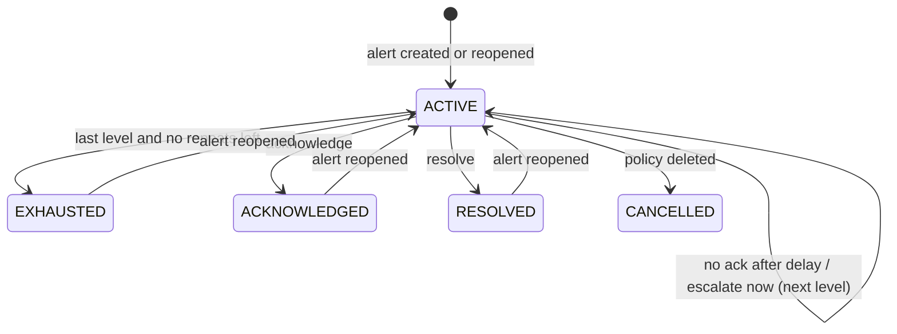

# Escalation

Package: `mayday.escalation`. File: `Escalation.kt`. API: `EscalationService` in `proto/mayday/v1/escalation.proto`. Web: `web/src/pages/Escalation.tsx` (on the On-call page and the alert page).

## Purpose

An escalation policy tells who Mayday pages when an alert fires, and who is next when nobody acknowledges in time. Team owners configure the policies of their team. Administrators set the limits that all teams must obey (through [policy](policy.md) settings).

## Model

| Element | Rules |
|---|---|
| `EscalationPolicy` | Team, name, description, `levels` (1–10), `repeat` (0–9 extra cycles), `teamDefault`, `version`. |
| `EscalationLevel` | `delayMinutes` (time to acknowledge before the next level is paged), `targets` (1–10). |
| `EscalationTarget` | `kind` SCHEDULE (the person on call of a schedule, of any team) or USER (one person), and `id`. |
| `Escalation` | One per alert (`id` = alert id): `policyId`, `status` (ACTIVE, ACKNOWLEDGED, RESOLVED, EXHAUSTED, CANCELLED), `level` (0-based), `cycle`, `nextAt`, `pages`, `version`. |
| `EscalationPage` | `at`, `level` (1-based), `cycle`, `userIds` (empty when nobody was reached), `manual`. |

## Rules

- A team has at most one default policy. Setting `teamDefault` on one policy clears it on the other policies of the team.
- A new alert starts an escalation when its severity is at or worse than `escalation.page_min_severity` and its team has a default policy. A reopened alert (firing again inside the deduplication window) starts again at level 1. The page history stays.
- A page goes to the people of all targets of the level: for a schedule, the person on call now (overrides apply); for a user, that user. Disabled users and duplicates are skipped.
- When a level reaches nobody, the next level is paged on the next tick. Otherwise the next level is paged `delayMinutes` after this page.
- After the last level, the policy starts again at level 1 while `cycle < repeat`. Then the escalation is EXHAUSTED and Mayday publishes `alert.escalation_exhausted`.
- Acknowledge stops the escalation (ACKNOWLEDGED). Resolve stops it (RESOLVED). Deleting the policy stops its escalations (CANCELLED).
- "Escalate now" pages the next level at once. On a firing alert without an active escalation it starts the team default policy at level 1, at any severity.
- Each page publishes `alert.paged` (team ids, level, user ids) and calls the `Pager` port. The state is saved before the page is sent, so two instances never send the same page.
- A schedule that was deleted, or a user that does not exist, reaches nobody.

## Settings (enforceable by administrators)

| Key | Default | Strict direction | Effect |
|---|---|---|---|
| `escalation.page_min_severity` | SEV3 | covers more severities | Alerts of this severity or worse page. NONE turns paging off. |
| `escalation.max_ack_minutes` | 30 | fewer minutes | The longest `delayMinutes` that a level of the team can have (1–1440). |

An administrator who sets `escalation.max_ack_minutes` to 15 as MINIMUM makes sure that no team waits more than 15 minutes before the next responder is paged. A policy with a longer delay is refused with `invalid`. The limit applies when a policy is saved.

## Access rules

| Action | Who |
|---|---|
| Read policies and escalations | Everyone with READ |
| Create, change, delete policies | Team owners: team role ADMIN, project admin of the team's project, or organization admin |
| Escalate now | Everyone with WRITE |
| Change the limits | Organization, project and team admins through settings; administrators enforce them |

## Ports

| Port | Adapters |
|---|---|
| `EscalationPolicyRepository` | `MemoryStore`, `PostgresStore` (table `escalation_policies`, index on `team_id`) |
| `EscalationRepository` | `MemoryStore`, `PostgresStore` (table `escalations`, partial index on `next_at` for ACTIVE, index on `policy_id`) |
| `Pager` | `Pager.none` (default), `WebhookPager` (`MAYDAY_PAGING_WEBHOOK_URL`, signed like agent webhooks with `MAYDAY_PAGING_WEBHOOK_SECRET`) |

Alerting calls the `AlertLifecycle` port (`opened`, `closed`); escalation implements it. On-call gives the person on call of a schedule (`OnCallService.onCallFor`). The server calls `tick()` every 15 seconds; each tick handles up to 500 due escalations.

## Positive use cases

- The Checkout owner creates "Default": level 1 the Primary schedule, 5 minutes; level 2 the Secondary schedule, 10 minutes; level 3 the team lead; repeat once.
- A SEV2 alert fires at 03:00. Ana (Primary) is paged. She does not acknowledge. At 03:05 Lee (Secondary) is paged. Lee acknowledges. The escalation stops.
- Sam has an override on Primary. The page goes to Sam, not to the rotation.
- A responder sees that the person on call is on a plane and presses "Escalate now". The next level is paged.
- The administrator enforces `escalation.max_ack_minutes` = 15 as MINIMUM. The team keeps a policy with 10 minutes.

## Negative use cases

- A team member creates or changes a policy: `forbidden`.
- A policy with no levels, a level with no targets, more than 10 levels, a delay of 0, a repeat of 10: `invalid`.
- A level with a delay above the effective `escalation.max_ack_minutes`: `invalid`.
- A target schedule or user that does not exist, or a disabled user: `invalid`.
- An update with an old version: `conflict`.
- A SEV5 alert with `escalation.page_min_severity` = SEV3: nobody is paged.
- "Escalate now" on an alert that is not firing, or for a team without a default policy: `invalid`.

## Rebuild checklist

Pass `EscalationTest`, the escalation part of `StoreContract`, the escalation part of `GrpcContractTest`, and the escalation part of `ProtoJsonContractTest`.
