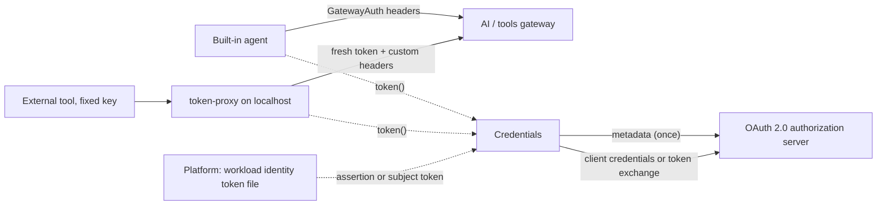

# Gateway identity

Packages: `mayday.adapters.credentials` (`Credentials.kt`) and `mayday.sidecar` (`TokenProxy.kt`). Contracts: `mayday.agents.Gateway.kt` (`CredentialSpec`, `OAuthGrant`, `ClientAuth`, `CredentialProvider`, `CredentialProviderFactory`, `GatewayAuth`, `GatewayError`, `statedCooldown`).

## Purpose

In enterprise clouds, the AI gateway and the tools gateway do not accept a static API key. They accept a short-lived token from an OAuth 2.0 authorization server, often with workload identity federation. Tokens expire. Mayday gets the token, refreshes it before it expires and adds it to each call, together with the custom headers that the gateway needs (for example an agent registry id in `x-company-agent-id`).

Mayday uses only the OAuth 2.0 standards. It has no code or settings for one identity provider. Any authorization server that implements these standards works: client credentials (RFC 6749), JWT client assertion (RFC 7523), token exchange (RFC 8693), issuer metadata (OIDC Discovery, RFC 8414) and resource indicators (RFC 8707).

The token proxy sidecar gives the same identity to tools that know only a fixed key and fixed headers (an external agent, a CLI). The tool calls the sidecar on localhost. The sidecar adds the fresh token and the custom headers and forwards the call to the gateway.



## Model

| Element | Rules |
|---|---|
| `CredentialSpec` | `mode` NONE, STATIC, OAUTH2 or FILE, plus the fields of that mode. Equal specs share one provider and one cached token. `toString()` shows no secret. `complete` tells if the fields are enough to get a token. |
| `OAuthGrant` | CLIENT_CREDENTIALS (default) or TOKEN_EXCHANGE. |
| `ClientAuth` | How a client secret goes to the token endpoint: BASIC (default, `client_secret_basic`) or POST (`client_secret_post`). |
| `Credentials` | `CredentialProviderFactory`. One provider per spec in a `ConcurrentHashMap`. Takes an `HttpClient` (5 s connect timeout), the `Telemetry` port and a clock. |
| `OAuth2Credential` | Gets and caches the access token with its expiry. Caches the discovered token endpoint. |
| `FileCredential` | Reads a token file that another process writes. |
| `GatewayAuth` | Custom `headers`, then the token in `Authorization: Bearer` (BEARER) or `x-api-key` (API_KEY). The token wins over a custom header of the same name. |
| `TokenProxy` | Local reverse proxy. `fromEnv(env)` builds a `Config`. `start(config)` returns a `Running` (`AutoCloseable`, with the bound `address`). |

## Rules

### OAuth 2.0 (mode OAUTH2)

- Token endpoint: `tokenUrl` when set. Else Mayday reads `token_endpoint` from the metadata of `issuer`:
  1. `GET <issuer>/.well-known/openid-configuration` (OIDC Discovery).
  2. On HTTP 404: `GET <origin>/.well-known/oauth-authorization-server<issuer path>` (RFC 8414).
  - The `issuer` in the metadata must equal the configured issuer (a trailing `/` is ignored). Else `GatewayError`.
  - Mayday keeps the endpoint for the life of the provider. A failed discovery is tried again at the next `token()`.
- Grant CLIENT_CREDENTIALS: `grant_type=client_credentials`. The client authenticates with one of:
  - Client secret, as HTTP Basic (`Authorization: Basic base64(urlencode(id):urlencode(secret))`, RFC 6749 2.3.1) or as `client_id` and `client_secret` form fields.
  - Else the assertion file as JWT client assertion: `client_id`, `client_assertion_type=urn:ietf:params:oauth:client-assertion-type:jwt-bearer`, `client_assertion` = file content (trimmed).
  - Neither: `GatewayError(0, ...)`.
- Grant TOKEN_EXCHANGE: `grant_type=urn:ietf:params:oauth:grant-type:token-exchange`, `subject_token` = assertion file content, `subject_token_type=urn:ietf:params:oauth:token-type:jwt` (a token parameter can replace it). Client authentication is optional: a client secret as above, else `client_id` alone when set.
- `scope` is sent when set. `tokenParams` add form fields, for example `audience`, `resource` or `requested_token_type`. They cannot replace `grant_type`, `client_id`, `client_secret`, `client_assertion`, `client_assertion_type`, `subject_token` or `scope`; the API refuses these names with `invalid`.
- Mayday reads the assertion file again on each fetch, because the platform rotates it.
- Lifetime: `expires_in` (number or string). Else the `exp` claim when the access token is a JWT (the signature is not checked; it only schedules the refresh). Else 5 minutes.
- Refresh margin = max(30 s, min(5 min, 20 % of the lifetime)), but not more than half of the lifetime. A call inside the margin fetches a new token.
- Only one fetch runs at a time per provider (coroutine `Mutex`). 1000 concurrent callers cause one HTTP call.
- `invalidate()` drops the cached token. The next `token()` fetches.
- A failed refresh while the cached token is still valid: Mayday keeps the cached token and tries again after 5 s. A failed fetch without a valid token: `GatewayError`.
- Token endpoint error: `GatewayError(status, "... answered HTTP <status>: <error>: <error_description>")`. Network error: `GatewayError(0, ...)`.
- Ready (`complete`): a token URL or an issuer, and for CLIENT_CREDENTIALS a client ID with a secret or an assertion file, for TOKEN_EXCHANGE an assertion file.

### Other modes

- NONE gives an empty token (no auth header). STATIC gives `staticSecret`.
- FILE reads `tokenFile` (trimmed). It reads the file again when its modification time changes or after `invalidate()`. A missing, unreadable or empty file: `GatewayError(0, ...)`.

### Secrets and telemetry

- Messages, logs and span attributes never contain a secret, an assertion or a token.
- Each real fetch opens one span `credential.fetch`: kind CLIENT for OAUTH2 (`mayday.credential.mode`, `mayday.credential.grant`, `mayday.credential.client_auth` = basic, post, assertion or none, `server.address`, `server.port`, `http.response.status_code`, `mayday.credential.expires_in`), kind INTERNAL for FILE.
- Discovery opens one span `credential.discover` (CLIENT, `server.address`, `mayday.credential.token_endpoint`).

### HTTP 429 cooldown

`statedCooldown(headers, body)` finds the wait that a 429 response states. The first source with a value wins:

1. `Retry-After` (RFC 9110): seconds or an HTTP date.
2. `retry-after-ms`: milliseconds.
3. `RateLimit` (`t=<seconds>`) and `RateLimit-Reset` (IETF RateLimit header fields).
4. `X-RateLimit-Reset`: seconds, or an epoch time stamp when the value is larger than 10⁹.
5. The longest of `anthropic-ratelimit-{requests,tokens,input-tokens,output-tokens}-reset` (RFC 3339 time) and `x-ratelimit-reset-{requests,tokens}` (durations such as `6m0s`).
6. A JSON body with a numeric `retry_after` (seconds) at the top level or in `error`.

Mayday reads header names and JSON structure only, never message text. No stated cooldown: the caller uses `DEFAULT_COOLDOWN` (15 minutes). The LLM adapters and the MCP client use this function; see [agents.md](agents.md) and [mcp.md](mcp.md) for the pause rules.

### Token proxy

- Start: `java -jar mayday.jar token-proxy`. No Spring. Configuration comes from environment variables only.
- It uses the same variable rules as the application (`MaydayProperties.Llm.environment()`). `MAYDAY_LLM_AUTH_STYLE` defaults to BEARER. Without `MAYDAY_LLM_CREDENTIAL`, a set API key means STATIC, else NONE.
- It forwards the method, the path (appended to the upstream base path), the query and the body.
- It drops hop-by-hop headers (`Connection`, `Keep-Alive`, `TE`, `Transfer-Encoding`, `Upgrade`, `Proxy-*`, `Host`, `Content-Length`, `Expect`), every incoming `Authorization`, `x-api-key` and each custom header name. Then it adds the `GatewayAuth` headers.
- It streams the response body chunk by chunk. Server-sent events flow without delay.
- HTTP 429 goes to the client unchanged, with its headers. The proxy never retries it.
- HTTP 401: the proxy invalidates the token and retries one time. It buffers request bodies up to 8 MiB for the retry. A larger body streams and is not retried.
- `GET /healthz` answers 200 `ok` and does not call the upstream.
- No credential: 503. Upstream not reachable: 502. The message has no secret.
- It uses `com.sun.net.httpserver` with one virtual thread per request and `java.net.http` (no redirects).

## Configuration

| Variable | Used by | Meaning |
|---|---|---|
| `MAYDAY_PROXY_LISTEN` | proxy | `host:port`, default `127.0.0.1:8787`. |
| `MAYDAY_PROXY_UPSTREAM` | proxy | Required. Base URL of the gateway, for example `https://ai-gateway.example.com/openai`. |
| `MAYDAY_LLM_AUTH_STYLE` | app, proxy | `bearer` or `api_key`. |
| `MAYDAY_LLM_CREDENTIAL` | app, proxy | `none`, `static`, `oauth2` or `file`. |
| `MAYDAY_LLM_API_KEY` (`ANTHROPIC_API_KEY`) | app, proxy | Static key. |
| `MAYDAY_LLM_ISSUER` | app, proxy | OIDC issuer for discovery of the token endpoint. |
| `MAYDAY_LLM_TOKEN_URL` | app, proxy | Token endpoint. Wins over discovery. |
| `MAYDAY_LLM_GRANT` | app, proxy | `client_credentials` (default) or `token_exchange`. |
| `MAYDAY_LLM_CLIENT_AUTH` | app, proxy | `basic` (default) or `post`. |
| `MAYDAY_LLM_CLIENT_ID` | app, proxy | OAuth 2.0 client ID. |
| `MAYDAY_LLM_CLIENT_SECRET` | app, proxy | Client secret. When set, the assertion file is not the client authentication. |
| `MAYDAY_LLM_ASSERTION_FILE` | app, proxy | Workload identity token file: client assertion or subject token. |
| `MAYDAY_LLM_SCOPE` | app, proxy | Scope, for example `ai-gateway.invoke`. |
| `MAYDAY_LLM_TOKEN_PARAMS` | app, proxy | Extra token request fields, `name=value,name2=value2`, for example `audience=https://ai-gateway.example.com`. |
| `MAYDAY_LLM_TOKEN_FILE` | app, proxy | Token file for mode `file`. |
| `MAYDAY_LLM_HEADERS` | app, proxy | Custom headers, `name=value,name2=value2`, for example `x-company-agent-id=mayday-prod`. |

An unknown grant or client authentication value, or a reserved token parameter, stops the start with a clear message.

### Example: Kubernetes workload identity

Kubernetes projects a short-lived service account token into the pod. The identity provider trusts the cluster's OIDC issuer and accepts the token as client assertion or as subject token. The Helm value `workloadIdentity` does the projection; without Helm:

```yaml
volumes:
  - name: workload-identity
    projected:
      sources:
        - serviceAccountToken: { path: token, audience: "https://idp.example.com", expirationSeconds: 3600 }
containers:
  - name: mayday
    volumeMounts:
      - { name: workload-identity, mountPath: /var/run/secrets/mayday/workload-identity, readOnly: true }
    env:
      - { name: MAYDAY_LLM_CREDENTIAL, value: oauth2 }
      - { name: MAYDAY_LLM_ISSUER, value: "https://idp.example.com" }
      - { name: MAYDAY_LLM_CLIENT_ID, value: mayday }
      - { name: MAYDAY_LLM_ASSERTION_FILE, value: /var/run/secrets/mayday/workload-identity/token }
      - { name: MAYDAY_LLM_SCOPE, value: "ai-gateway.invoke" }
      - { name: MAYDAY_LLM_HEADERS, value: "x-company-agent-id=agent-0042" }
```

For an identity provider that exchanges the platform token (RFC 8693), set `MAYDAY_LLM_GRANT=token_exchange` and, if it needs one, `MAYDAY_LLM_TOKEN_PARAMS=audience=<value>`. When a cloud webhook writes the token file (and sets annotations and labels), point `MAYDAY_LLM_ASSERTION_FILE` to that file instead of using the projection.

Sidecar for an external tool in the same pod:

```yaml
- name: token-proxy
  image: mayday:latest
  args: ["token-proxy"]
  env:
    - { name: MAYDAY_PROXY_UPSTREAM, value: "https://ai-gateway.example.com/openai" }
    - { name: MAYDAY_LLM_CREDENTIAL, value: oauth2 }
    - { name: MAYDAY_LLM_ISSUER, value: "https://idp.example.com" }
    - { name: MAYDAY_LLM_CLIENT_ID, value: mayday }
    - { name: MAYDAY_LLM_ASSERTION_FILE, value: /var/run/secrets/mayday/workload-identity/token }
    - { name: MAYDAY_LLM_HEADERS, value: "x-company-agent-id=agent-0042" }
```

The tool then uses `http://127.0.0.1:8787` as its base URL and any placeholder key.

## Positive use cases

- In Kubernetes, the built-in agent calls the AI gateway with a token from workload identity federation. No secret is stored. The kubelet rotates the projected token and Mayday reads the new file on the next fetch.
- Only the issuer is configured. Mayday finds the token endpoint in the issuer metadata at the first call.
- An identity provider wants `client_secret_post`. The administrator sets client authentication to POST.
- An identity provider needs an `audience` or `resource` field. The administrator adds it as a token parameter.
- An identity provider issues gateway tokens through token exchange. Mayday sends the platform token as subject token.
- 500 agent runs start at the same time. They share one token and the token endpoint gets one request.
- The token has 2 minutes left. The next call gets a new token before the gateway refuses the old one.
- The gateway answers 401 after a key rotation. The proxy gets a new token and the retry succeeds.
- A CLI that accepts only `OPENAI_API_KEY` and `OPENAI_BASE_URL` uses the sidecar. Each request carries a fresh token and the custom headers.
- A Vault agent writes a token to a file. Mode `file` picks up each new token.
- A gateway that needs no agent id gets no agent id header: custom headers are optional.

## Negative use cases

- The client secret is wrong. `GatewayError(401, "... invalid_client: ...")`. The secret is not in the message, the log or the span.
- The workload identity token file is missing (no projection). `GatewayError(0, "The assertion file ... does not exist")`.
- The issuer metadata names another issuer. `GatewayError`, and no token request goes out.
- The issuer has no metadata at either well-known path. `GatewayError(404, ...)`.
- A token parameter named `client_secret` or `scope`: the API answers `invalid`; the environment variable stops the start.
- The token endpoint is down while the cached token is still valid. Calls continue with the cached token. After expiry, calls fail with `GatewayError`.
- The gateway answers 429 (budget used up). The proxy returns the 429 with its headers and does not retry. The built-in agent raises `BudgetExhausted` with the stated cooldown.
- The gateway answers 401 two times. The client gets the second 401. The proxy does not loop.
- A client sends its own `Authorization` or a configured custom header to the proxy. The proxy drops it and sends the real identity.
- `MAYDAY_PROXY_UPSTREAM` is not set. The proxy stops at start with exit code 2.

## Rebuild checklist

Pass `CredentialsContractTest` (client secret Basic and POST, token parameters and reserved fields, client assertion and rotation, token exchange with and without client authentication, OIDC and RFC 8414 discovery, issuer mismatch, single-flight cache, proactive refresh, JWT `exp`, invalidate, refresh failure, error messages without secrets, spans, file mode), `TokenProxyContractTest` (identity injection and stripping, discovery and token exchange from the environment, token rotation, 429 pass-through, 401 refresh and retry, streaming, `/healthz`), `LlmSettingsContractTest` and the cooldown test in `GatewaySettingsTest`.
