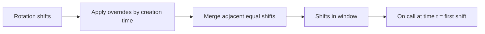

# On-call

Package: `mayday.oncall`. File: `OnCall.kt`. API: `OnCallService` in `proto/mayday/v1/oncall.proto`. Web: `web/src/pages/OnCall.tsx`.

## Purpose

On-call tells who responds for a team at a given time. Teams have schedules (rotations of team members). When a person is sick or has other duties, an override puts another team member on call for a set period.

## Model

| Element | Rules |
|---|---|
| `Schedule` | Team, name, IANA time zone, `rotationStart` (first handoff), `shiftLength` + `shiftUnit` (HOURS, DAYS, WEEKS), `participants` (user ids in rotation order), `version`. |
| `ScheduleOverride` | Schedule, team, `userId` (who covers), `startsAt` (inclusive), `endsAt` (exclusive), reason, `createdBy`, `createdAt`. |
| `Shift` | Computed, never stored: one continuous period with one person (`userId` null = nobody), and the `overrideId` when an override gives it. |
| `OnCall` | Computed: for each schedule, the person on call at a time, `until` (end of the shift) and the override, if any. |

## Rotation rules (`Rotation`, pure functions)

- Shift k starts at `rotationStart` + k × `shiftLength` units. DAYS and WEEKS count in the schedule's time zone: a 09:00 handoff stays at 09:00 local time across daylight saving changes. HOURS count absolute time.
- The person of shift k is `participants[k mod n]`.
- Before `rotationStart`, nobody is on call. A schedule without participants has nobody on call.
- Overrides apply in creation order: each one replaces what is below it in its period. So a later override wins over an earlier one.
- Adjacent equal shifts merge. Results are cut to the requested window.

## Access rules

| Action | Who |
|---|---|
| Read schedules, overrides, shifts, who is on call | Everyone with READ |
| Create, change, delete schedules | Team owners: team role ADMIN, project admin of the team's project, or organization admin |
| Create an override for any team member | Team owners |
| Create an override for yourself | Team members (any team role), with WRITE |
| Remove an override | Team owners, and the person who covers |

An agent with a delegated token has the rules of the person (a member's agent can add only that member).

## Integrity rules

- Participants and override users must be team members. A disabled user cannot cover.
- Time zone must be a valid IANA zone. Shift length: 1–744 hours, 1–365 days, 1–52 weeks. A person is in a rotation only once.
- An override ends after it starts, ends in the future, and is at most 366 days long.
- Query windows (shifts, overrides) are at most 93 days.
- Schedule changes use optimistic concurrency (`version`).
- When a person leaves a team (manual removal, admin change, or identity provider groups), Mayday removes them from that team's rotations. Their future overrides of the team are deleted; a running override ends now. Identity calls the `TeamMembershipListener` port; on-call implements it.
- Deleting a schedule deletes its overrides.
- Every change publishes `oncall.changed` with the team id. The web interface reloads on it.

## Ports

| Port | Adapters |
|---|---|
| `ScheduleRepository` | `MemoryStore`, `PostgresStore` (table `schedules`) |
| `OverrideRepository` | `MemoryStore`, `PostgresStore` (table `schedule_overrides`, indexes on `(schedule_id, ends_at)` and `(team_id, user_id, ends_at)`) |

The service reads users through `UserRepository` and teams through `DirectoryService`. Escalation asks `onCallFor(scheduleId, at)` (the person on call, overrides applied) and `exists(scheduleId)`; see [escalation.md](escalation.md).

## MCP tools

- `get_on_call` (read): who is on call now or at a time, for some or all teams.
- `add_schedule_override` (write, needs `mcp.write` for the team): the same rules as above.

## Positive use cases

- The Checkout owner creates "Primary": weekly, Monday 09:00 Europe/Berlin, Ana → Sam → Lee.
- Ana is sick. Sam adds himself as override from now until Friday 18:00. The On-call page shows Sam, "until Fri 18:00", and an Override badge.
- The owner plugs in Lee for Sam's week while Sam is at a conference.
- An incident commander asks the agent "who is on call for SRE?". The agent calls `get_on_call`.
- Lee leaves the team. Lee is gone from the rotation and from future overrides.

## Negative use cases

- A team member adds another person as override: `forbidden`.
- A viewer or a person outside the team adds themselves: `forbidden`.
- An owner adds a person who is not a team member: `invalid`.
- An override that ends before it starts, ended in the past, or is longer than 366 days: `invalid`.
- A member creates or changes a schedule: `forbidden`.
- Time zone `Mars/Olympus`, shift length 0, a person twice in the rotation: `invalid`.
- A schedule update with an old version: `conflict`.
- A shift window longer than 93 days: `invalid`.

## Rebuild checklist

Pass `RotationTest`, `OnCallTest`, the on-call part of `StoreContract`, the on-call part of `GrpcContractTest`, and the on-call part of `ProtoJsonContractTest`.
