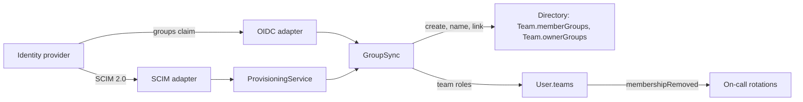

# Provisioning (teams from identity provider groups)

Package: `mayday.provisioning`. File: `Provisioning.kt`. Adapters: `adapters/auth/Oidc.kt` (groups claim), `adapters/scim/ScimEndpoints.kt` (SCIM 2.0).

## Purpose

Large organizations keep team membership in their identity provider (Microsoft Entra ID, Okta, Keycloak, Google, JumpCloud, OneLogin). Provisioning makes Mayday teams follow those groups, so nobody keeps two lists. It uses only open standards: the OpenID Connect groups claim and SCIM 2.0 (RFC 7643, RFC 7644). No vendor API, no vendor SDK.

## Two sources, one model

| Source | When it updates | What it stores |
|---|---|---|
| Groups claim in the ID token or access token | At each sign-in and each request with an SSO access token | `User.idpGroups` (replaced each time) |
| SCIM 2.0 push from the identity provider | When the provider syncs (Entra: about every 40 minutes; also deprovisioning) | `DirectoryGroup` records and `User.scimGroups` (group keys) |

A user's groups = `idpGroups` ∪ `scimGroups`. A group key is the SCIM `externalId` (Entra: the group object id) or else the display name. The groups claim must send the same identifiers (Entra: object ids by default).

## Team links

- `Team.memberGroups`: members of these groups are team members. When the set is not empty, the identity provider owns the membership.
- `Team.ownerGroups`: members of these groups are team owners (team role ADMIN) and team members. When the set is not empty, the identity provider owns the owner role.
- Administrators set links in Settings → Teams & projects → Groups, or with `UpdateTeam` and `replace_groups`. Removing all links keeps the current members as manual members.

## Reconcile rule (`GroupSync.desired`, pure)

For each team with links:

| `memberGroups` | `ownerGroups` | Result |
|---|---|---|
| set | set | In an owner group → ADMIN. Else in a member group → MEMBER. Else removed. |
| set | empty | In a member group → member (new members MEMBER, existing role kept). Else removed. |
| empty | set | In an owner group → ADMIN. Else an ADMIN becomes MEMBER. Members stay manual. |

Teams without links never change. Every removal calls `TeamMembershipListener` (on-call removes the person from rotations).

## Automatic teams

Off by default. Settings (environment):

| Variable | Effect |
|---|---|
| `MAYDAY_GROUPS_AUTO_CREATE` | `true`: a group that no team links to creates a team (name = display name or key, free slug) |
| `MAYDAY_GROUPS_FILTER` | Regular expression. Only matching groups (key or display name) create teams. Empty = all |
| `MAYDAY_GROUPS_OWNER_SUFFIX` | For example `-owners`: group `payments-owners` becomes the owner group of the team of group `payments` |
| `MAYDAY_OIDC_GROUPS_CLAIM` | Claim name, default `groups`. A dotted path reads a nested claim (Keycloak: `realm_access.roles`). Blank turns claim sync off |

A team made from a claim gets the key as name (Entra: an object id). When SCIM later sends the group, the team gets its display name.

## Groups claim rules

- A list of strings, or one string with commas or spaces.
- A missing claim means no groups: Entra ID and Keycloak leave the claim out for a user without groups.
- OpenID Connect Core 5.6.2 distributed claims (`_claim_names` contains the claim; Entra "group overage" above 200 groups): the groups are unknown and Mayday changes nothing. Use SCIM, or "groups assigned to the application" in Entra.
- When the groups did not change since the last sign-in, Mayday does no work.

## SCIM 2.0

Base URL: `<public URL>/scim/v2`. Authentication: `Authorization: Bearer <token>` with the SCIM scope. Only administrators can create such a token (Settings → API tokens). Session cookies and agents have no access.

| Endpoint | Behavior |
|---|---|
| `GET /ServiceProviderConfig`, `/ResourceTypes`, `/Schemas` | Discovery. PATCH supported, bulk, sort, ETag not supported |
| `GET /Users?filter=&startIndex=&count=` | Filters: `userName`, `externalId`, `id`, `emails`, `emails.value` with `eq`. Count at most 500 |
| `POST /Users` | Creates a user. Email = `userName` when it is an email, else the primary email. Duplicate email: 409 `uniqueness` |
| `GET`, `PUT`, `PATCH /Users/{id}` | PATCH: `add`, `replace`, `remove`, any case. Accepts Entra string booleans (`"False"`), Okta value objects (no path), `emails[type eq "work"].value`. Unknown paths (for example enterprise extension) are ignored |
| `DELETE /Users/{id}` | Disables the user and removes their SCIM groups. The user stays for the incident history |
| `GET /Groups?filter=&excludedAttributes=members` | Filters: `displayName`, `externalId`, `id` with `eq` |
| `POST`, `PUT`, `PATCH`, `DELETE /Groups/{id}` | PATCH: `members` add, remove, replace; `members[value eq "id"]` remove; `displayName`, `externalId`. A changed key moves members and team links |

Errors use the SCIM error schema with `status`, `scimType` (`invalidFilter`, `uniqueness`, `invalidValue`) and `detail`. Content type `application/scim+json`. SCIM-created users get the role MEMBER, or ADMIN when their email is in `MAYDAY_ADMIN_EMAILS`.

## Set up Microsoft Entra ID (example)

1. Enterprise application → Single sign-on: OIDC app registration with redirect URI `<public URL>/auth/callback`. Token configuration → add groups claim (Security groups or "Groups assigned to the application", ID and access tokens).
2. Provisioning → Automatic. Tenant URL `<public URL>/scim/v2`, secret token = a Mayday token with the SCIM scope. Map Users (`userPrincipalName` → `userName`) and Groups. Assign the groups.
3. In Mayday: either `MAYDAY_GROUPS_AUTO_CREATE=true` with a filter such as `^oncall-`, or link groups to existing teams.

Okta, OneLogin, JumpCloud: the same two steps with their SCIM app. Keycloak: add a "Group Membership" mapper with claim `groups` and "Full group path" off.

## Positive use cases

- Ana is in Entra groups `oncall-payments` and `oncall-payments-owners`. At her first sign-in Mayday creates team "oncall-payments" and makes her an owner.
- IT removes Ben from `oncall-payments`. At the next SCIM sync (or Ben's next sign-in) Ben leaves the team and its rotations.
- An administrator links the existing team SRE to group object id `8f1c…`. All members of the group become SRE members now.
- IT deprovisions a person who left the company. SCIM disables the account and removes their team memberships.

## Negative use cases

- A team owner adds or removes a member of a team with member groups: `conflict`.
- A team owner promotes a member of a team with owner groups: `conflict`. An administrator's `UpdateUser` with such a change: `conflict`.
- A token with the group overage marker: no change.
- A member creates a token with the SCIM scope: the scope is dropped.
- A SCIM call with a session cookie or without a token: 401. With a token of a non-administrator, or without the SCIM scope: 403.
- Filter `name.familyName co "x"`: 400 `invalidFilter`.
- POST of a user with an existing email: 409 `uniqueness`.
- The SCIM token owner deactivates or deletes themselves: 409.

## Rebuild checklist

Pass `GroupClaimTest`, `GroupSyncTest`, `ProvisioningTest`, `TeamMembersTest`, `ScimContractTest`, `OidcGroupSyncContractTest` (Keycloak container), the group part of `StoreContract`, and the group-link parts of `GrpcContractTest` and `ProtoJsonContractTest`.
