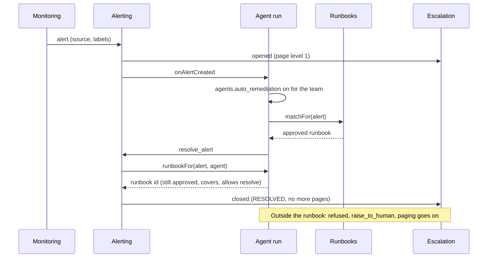

# Runbooks for agents

Package: `mayday.runbooks`. File: `Runbooks.kt`. Scope guard: `mayday.agents.RunbookScope`. API: `RunbookService` in `proto/mayday/v1/runbooks.proto`. MCP tools: `list_runbooks`, `get_runbook`, `draft_runbook`, `approve_runbook`, `revoke_runbook`. Web: `web/src/pages/Runbooks.tsx` (card "Runbooks for agents" on the On-call page of a team).

## Purpose

A runbook is a standard operating procedure for one type of alert. A team owner approves it for agentic use. The team must also allow automatic agent remediation (`agents.auto_remediation`, see [policy.md](policy.md)): the approval says which procedure, the policy says that agents can do autonomous work at all. Then an automated agent (an agent with no person behind it) follows it and closes these alerts with no person. Any other close by an automated agent keeps a human in the loop: paging goes on until a person acknowledges ([escalation.md](escalation.md)). When the agent fails, or meets a case that the runbook does not cover, it raises the alert to a person.

The incident document `Runbook` (title and Markdown, generated from the resolution notes, see [incidents.md](incidents.md)) is a different thing: it is a record on one incident with no approval. A person can copy its text into a runbook draft.

## Model

| Element | Rules |
|---|---|
| `Runbook` (aggregate root) | `teamId`, `title`, `body` (Markdown procedure), `match`, `allowedTools`, `status`, `approvedBy`/`approvedAt`, `revokedBy`/`revokedAt`, `createdBy`, `createdAt`, `updatedAt`, `version` (optimistic concurrency). Title, body and at least one match criterion are mandatory. |
| `AlertMatch` | `source` (equal, case does not matter), `labels` (all equal), `fingerprint` (pattern, `*` matches any text). An empty criterion matches all alerts. The runbook covers only alerts of its own team. |
| `RunbookStatus` | DRAFT → APPROVED → REVOKED. A change of the text, the match or the tools makes it a DRAFT again. A revoked runbook can be approved again. |
| `allowedTools` | Up to 50 tool names (`[A-Za-z0-9_.:-]`, 1–64 characters). The write tools that an agent can call while it follows the runbook. `resolve_alert` lets the agent resolve the alert with no person, by the MCP tool or by gRPC `ResolveAlert`. The read tools (`list_incidents`, `get_incident`, `list_alerts`, `get_alert`, `list_teams`, `get_on_call`, `get_settings`, `list_runbooks`, `get_runbook`) are always allowed. |
| `AgentRun.alertId`, `.runbookId`, `.runbookTitle`, `.raisedAt` | The alert that started an automatic run, the approved runbook that the run follows, and when the run raised its alert to a person ([agents.md](agents.md)). |
| `Alert.resolvedBy`, `.resolvedUnderRunbook` | Who resolved the alert, and the runbook that the automated agent followed ([alerting.md](alerting.md)). |

## Rules

- Draft: everybody with write access (also agents) creates a draft for any team.
- Change: a draft changes with write access. A change of an APPROVED runbook needs a team owner, and the runbook is a DRAFT again. A person must approve the new text before agents follow it.
- Approve: a team owner (team role ADMIN, project admin of the team's project, or organization admin) approves, as a person. Agents, delegated tokens and the system cannot approve (`forbidden`). The request carries the version that the person read. A different current version is a `conflict`, so nobody approves a text that they did not see. A second approval is a `conflict`.
- Revoke: a team owner revokes an approved runbook. A runbook that is not approved gives `conflict`.
- Autonomy: a runbook acts only while `agents.auto_remediation` is true for the alert team. When it is false, an automatic run follows no runbook, `runbookFor` covers nothing, and the built-in agent refuses the next write step of a run in progress and raises the alert to a person. The approval stays valid. The runbook card shows a warning to everyone when an approved runbook exists, and to team owners in all cases: what is blocked, who blocked it (organization or project administrators when they locked the setting), and the consequences for automatic runbook runs.
- Alerts stay visible: a covered alert opens and pages level 1 like any other alert. With an approved runbook the alert is information for the on-call person: the agent works on it, and the person acts only when the agent raises it or paging goes on.
- Match: when an alert starts an automatic run, Mayday picks the approved runbook of the alert's team that covers the alert. The most specific runbook (most criteria) wins, then the latest approval. The run records it. Manual runs follow no runbook: a person is behind them.
- Follow: the built-in agent gets the runbook text in its task (a person approved it, so it is not untrusted subject data). External agents get the runbook in the subject data (`subject.runbook`) of the webhook or the claimed run, and `run.runbookId`.
- Scope (built-in agent): the agent sees only the read tools, the allowed tools and `raise_to_human`. A call of another tool is refused with `forbidden` and raises the alert to a person. A write call after the runbook was changed or revoked is refused in the same way.
- Resolve with no person: a resolve by an automated agent stops paging only when that agent has an active run that this alert started, the run did not raise the alert, and the run's runbook is still approved, still covers the alert and allows `resolve_alert`. Mayday then sets `resolvedUnderRunbook`. Any other resolve by an automated agent leaves the alert RESOLVED and waiting for a person. For external agents Mayday enforces and audits only what it sees: the run, the runbook and the resolve. The audit log of the external agent's own steps is the external agent's concern.
- Raise to a person, once per run: the agent calls `raise_to_human` with the reason, calls a tool outside the runbook, or the run fails or is cancelled. Mayday sets `raisedAt`, adds the reason to the alert (and the incident timeline when `timeline.auto_populate` is on), clears `resolvedUnderRunbook`, records `run.raised_to_human` in the audit stream, and starts paging when no escalation is active, at any severity.
- Each change publishes `runbook.created`, `runbook.updated`, `runbook.approved` or `runbook.revoked` (team ids) and goes to the audit stream (category `agent`).

## Access rules

| Action | Who |
|---|---|
| List, read | Everyone with READ |
| Draft, change a draft | Everyone with WRITE (also agents) |
| Change an approved runbook, revoke | Team owners |
| Approve | Team owners, as a person (no agent, no delegated token) |

## Ports

| Port | Adapters |
|---|---|
| `RunbookRepository` (`get`, `byTeam`, `save(expectedVersion)`, `delete`) | `MemoryStore` (collection `runbooks`), `PostgresStore` (table `runbooks`, index on `team_id`) |
| `RunbookCoverage` (alerting) | `AgentService.runbookFor` |
| `AlertLifecycle.needsHuman` (alerting) | `EscalationService` |

## Positive use cases

- The Checkout team writes "Disk full on db hosts" for source `prometheus` and label `service=db`, with `resolve_alert`. The team lead reads it and approves version 1. At 03:00 the disk alert fires. The built-in agent deletes old logs with the allowed gateway tool, checks the disk, and resolves the alert. Paging stops. The alert shows "Resolved under an approved runbook".
- An external pull agent claims the run, reads `subject.runbook`, does the steps and calls `ResolveAlert` with its own token. Paging stops.
- The agent finds database files on the disk and no old logs. It calls `raise_to_human` with the reason. The on-call person is paged and sees the reason on the alert.
- The lead changes the procedure. The runbook is a draft again. Agents follow no runbook on new alerts until the lead approves the new version.
- The team lead approves a runbook while the organization administrators keep `agents.auto_remediation` locked off. The card shows the warning with the consequences. When the administrators allow it, agents follow the runbook from the next alert.
- An administrator revokes a runbook during an outage. Running agents cannot use their write tools any more and raise their alerts to a person.

## Negative use cases

- A member approves a runbook: `forbidden`. The built-in agent, an external agent or a delegated token approves: `forbidden`.
- The lead approves version 1 while a teammate saved version 2: `conflict`.
- A runbook with no source, labels or fingerprint, an empty title or body, or a tool name with spaces: `invalid`.
- A member changes an approved runbook: `forbidden`.
- An automated agent resolves an alert that no approved runbook covers, or resolves with no run on that alert: the alert is RESOLVED, but paging goes on until a person acknowledges or the monitoring source resolves it.
- The runbook does not allow `resolve_alert`: the agent cannot resolve the alert alone.
- The agent following the runbook calls `acknowledge_alert`, which the runbook does not allow: `forbidden`, the alert does not change, and a person is paged.
- A runbook of another team, a draft or a revoked runbook covers nothing.
- `agents.auto_remediation` is off for the alert team: the approved runbook covers nothing, the run follows no runbook, and an agent resolve waits for a person.
- An automated agent closes a declared incident: its raised alerts are resolved but keep paging.

## Rebuild checklist

Pass `RunbookTest`, the runbook parts of `StoreContract`, `GrpcContractTest` (runbook service and agent resolve), `HttpEdgesContractTest` (MCP runbook tools) and use case 8 of `UseCaseTest`.
