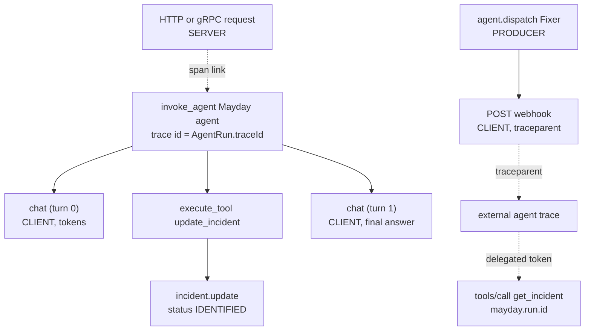

# Observability

Mayday sends OpenTelemetry traces. Operators use them to see what an agent did during an incident: each LLM call, each tool call and each change that the tool made. Requests, alert intake and webhooks are traced too.

Metrics stay on Prometheus at `/metrics` (see [deployment.md](deployment.md)).

## Design

- The domain uses the `Telemetry` port (`mayday.shared.Telemetry`). It has no OpenTelemetry types. `Telemetry.noop` is the default, so `App` runs without tracing.
- `adapters/telemetry/OtelTelemetry` implements the port with the OpenTelemetry API. The span is current in the coroutine context (`asContextElement()`), so it stays the parent across `delay`, `withContext` and dispatcher changes.
- `adapters/telemetry/TelemetryConfiguration` adds Mayday settings to Spring Boot's OpenTelemetry auto-configuration (`spring-boot-starter-opentelemetry`): sampler, resource attributes, `MAYDAY_OTEL_ENDPOINT`, the global SDK instance and Reactor context propagation.
- `Wiring` (in `MaydayApplication.kt`) gives the `Telemetry` bean to `Ports`, the webhook dispatcher, the credentials and the LLM adapters.
- Spring observations make the server spans for HTTP, gRPC-Web (HTTP span) and native gRPC. Domain spans of a request are children of its server span.
- A failed block sets the span status to ERROR, records the exception and sets `error.type` (the domain error code, for example `forbidden`, or the exception class). A cancelled coroutine is not an error: the span gets `mayday.cancelled=true`.
- Span names have low cardinality. Ids are attributes, not names. Agent names and tool names come from configuration and are few.

## Spans

| Span name | Kind | Key attributes | Parent |
|---|---|---|---|
| HTTP `POST /api/v1/alerts` and others | SERVER | `http.*` (Spring) | caller or root |
| `mayday.v1.<Service>/<Method>` | SERVER | `rpc.*` (Spring gRPC) | caller or root |
| `alert.ingest` | INTERNAL | `mayday.alert.source`, `.severity`, `.status`, `.outcome` (`created`, `deduplicated`, `reopened`, `resolved`), `.id`, `.team_id`, `.count`, `mayday.incident.key` | request span |
| `incident.declare` | INTERNAL | `mayday.incident.trigger` (`manual`, `alert`), `.severity`, `.id`, `.key`, `mayday.actor.kind` | request, `alert.ingest` or `execute_tool` |
| `incident.update` | INTERNAL | `mayday.incident.id`, `.key`, `.status.from`, `.status.to`, `.severity`, `mayday.actor.kind`; events `incident.resolved`, `incident.reopened` | request or `execute_tool` |
| `agent.alert_triggers` | INTERNAL | `mayday.alert.id` | root (background) |
| `invoke_agent <agent>` | INTERNAL | `gen_ai.operation.name=invoke_agent`, `gen_ai.agent.id`, `gen_ai.agent.name`, `gen_ai.conversation.id` (run id), `gen_ai.provider.name`, `gen_ai.request.model`, `mayday.run.*` | root (background run) |
| `chat` | CLIENT | `gen_ai.operation.name=chat`, `gen_ai.response.model`, `gen_ai.response.finish_reasons`, `gen_ai.usage.input_tokens`, `gen_ai.usage.output_tokens`, `mayday.agent.turn` | `invoke_agent` |
| `execute_tool <tool>` | INTERNAL | `gen_ai.operation.name=execute_tool`, `gen_ai.tool.name`, `gen_ai.tool.call.id`, `mayday.tool.error` | `invoke_agent` |
| `agent.dispatch <agent>` | PRODUCER | `gen_ai.agent.*`, `mayday.run.*` | root (background run) |
| `POST webhook` | CLIENT | `http.request.method`, `server.address`, `server.port`, `http.response.status_code`, `http.request.resend_count`, `mayday.agent.id`, `mayday.run.id` | `agent.dispatch` |
| `tools/call <tool>` | INTERNAL | `mcp.method.name`, `gen_ai.operation.name=execute_tool`, `gen_ai.tool.name`, `jsonrpc.request.id`, `mayday.actor.kind`, `mayday.actor.delegated`, `mayday.run.id`, `error.type` | HTTP `POST /mcp` |

The built-in agent calls the Mayday tools directly. `execute_tool` is the only tool span for these calls; the tools have no span of their own. External agents call the same tools through MCP; `tools/call` is the tool span for them.

### GenAI and MCP conventions

Mayday uses the OpenTelemetry semantic conventions for generative AI (`gen_ai.*`, operations `invoke_agent`, `chat`, `execute_tool`) and for MCP (`mcp.method.name`, `jsonrpc.request.id`). Mayday-specific attributes start with `mayday.`.

### Content capture and privacy

Prompts, model answers and tool arguments are not exported by default. Set `MAYDAY_OTEL_CAPTURE_CONTENT=true` to add them: `gen_ai.choice` events on `chat`, `gen_ai.tool.call.arguments` on `execute_tool` and `tools/call` (each value is cut at 8000 characters). This content can contain incident data and personal data. Turn it on only when the trace backend has the same access control as Mayday.

Mayday never puts tokens, secrets, API keys or e-mail addresses in attributes. Users and agents appear as ids and actor kinds.

## Background agent runs: links, not one long trace

An agent run starts from a request or an alert and then runs in the background for seconds to minutes. Mayday starts a new trace for each run (`invoke_agent` or `agent.dispatch` is the root span). Reasons:

- The request trace stays short and its latency stays correct.
- Each run is one trace. Operators find it from the run (`AgentRun.traceId`).
- Sampling of runs is independent of request sampling (see below).

The run span can link to the span that started the run: a span attribute `mayday.link.traceparent` (a W3C `traceparent`) becomes a span link and is not stored as an attribute. A push agent receives the `traceparent` header of `POST webhook`, so the trace of the agent continues the run trace.

## Follow an agent run during an incident

1. Open the incident and its agent runs. Each run has a trace id (`AgentRun.traceId`). The value is empty when the run was not sampled or tracing is off.
2. Search for the trace id in the trace backend (Jaeger, Tempo, Honeycomb, Datadog and others).
3. Read the trace: `invoke_agent` → `chat` (one per model turn, with token use) and `execute_tool <tool>` (one per tool call) → domain spans such as `incident.update` with the change that the tool made.
4. Failed tool calls have status ERROR and `mayday.tool.error=true`. A run that failed has `mayday.run.status=FAILED` and the exception.
5. For external agents, search for `mayday.run.id=<run id>` on `tools/call` spans: each MCP call of the agent with the delegated token of the run has it.

## Configuration

Spring Boot reads the standard `OTEL_*` variables too (for example `OTEL_EXPORTER_OTLP_HEADERS`, `OTEL_RESOURCE_ATTRIBUTES`, `OTEL_SERVICE_NAME`, `OTEL_SDK_DISABLED`). They have priority over `application.yaml`.

| Variable | Default | Effect |
|---|---|---|
| `MAYDAY_OTEL_ENDPOINT` | empty | OTLP base URL, for example `http://otel-collector:4318`. Mayday adds `/v1/traces` and `/v1/metrics` for HTTP. It has priority over `OTEL_EXPORTER_OTLP_ENDPOINT`. |
| `OTEL_EXPORTER_OTLP_ENDPOINT`, `OTEL_EXPORTER_OTLP_TRACES_ENDPOINT` | empty | Standard alternatives. Without any endpoint Mayday exports no spans and makes no network calls for telemetry. |
| `MAYDAY_OTEL_TRANSPORT` | `http` | `http` (port 4318) or `grpc` (port 4317). |
| `MAYDAY_OTEL_SAMPLING` | `1.0` | Ratio of new traces that are sampled (0.0 to 1.0). Parent-based: a request with a sampled `traceparent` is always sampled. `OTEL_TRACES_SAMPLER_ARG` has priority. |
| `MAYDAY_OTEL_SAMPLE_AGENT_RUNS` | `true` | Sample each agent run root span, also when the ratio drops other traces. |
| `MAYDAY_OTEL_CAPTURE_CONTENT` | `false` | Export prompts, answers and tool arguments. See the privacy note. |
| `MAYDAY_OTEL_METRICS` | `false` | Also push metrics with OTLP. `OTEL_METRICS_EXPORTER=otlp` does the same. Prometheus at `/metrics` stays on. |
| `MAYDAY_ENVIRONMENT` | empty | Resource attribute `deployment.environment`, for example `production`. |

Resource attributes: `service.name=mayday` (from `spring.application.name`), `service.version`, `deployment.environment` when set.

Mayday registers its SDK as `GlobalOpenTelemetry`, so libraries that use the global instance (for example the Anthropic Java SDK) share the exporter and the context.

## Sampling at scale

At 50,000 to 100,000 users most spans come from requests. Agent runs are few (thousands each day) and are always sampled by default.

- Small installations: keep `MAYDAY_OTEL_SAMPLING=1.0`.
- Large installations: set `MAYDAY_OTEL_SAMPLING=0.05` to `0.1`. Keep `MAYDAY_OTEL_SAMPLE_AGENT_RUNS=true`. Alert intake and incident changes from agents stay complete in the run trace.
- Use an OpenTelemetry Collector near Mayday for batching, tail sampling and retries. Mayday sends batches (Spring defaults: queue 2048 spans, batch 512, delay 5 s). When the queue is full, Mayday drops spans and does not block requests.
- An unsampled span costs a few object allocations. Attributes are not recorded on unsampled spans.

## Use cases

Positive:

- An operator opens a failed agent run, copies the trace id and sees that the third tool call returned `forbidden` because the delegating user is a viewer of the team.
- An operator sees that an agent run took 90 s, of which 80 s were in two `chat` spans with 150,000 input tokens.
- An SRE follows an alert from the Alertmanager webhook (`POST /api/v1/integrations/alertmanager`) through `alert.ingest` to the automatic `incident.declare`.
- A push agent continues the trace from the `traceparent` header and its MCP calls back to Mayday carry `mayday.run.id`.

Negative:

- No endpoint is set: Mayday starts, runs and logs no export errors. Runs still get a trace id, but no backend has it.
- `MAYDAY_OTEL_SAMPLING=0` and `MAYDAY_OTEL_SAMPLE_AGENT_RUNS=false`: runs have an empty trace id.
- Content capture is off: the trace shows which tools ran and their status, but not the prompts or arguments.
- A request without a server span parent (for example a gRPC-Web call, see limitations) starts its own trace.

## Limitations

- gRPC-Web: the bridge does not forward the trace context to the in-process gRPC call yet. The HTTP span and the gRPC span of one gRPC-Web call are in two traces.
- The link from a background run to the request that started it needs the agents context to send `mayday.link.traceparent` with the run span.
