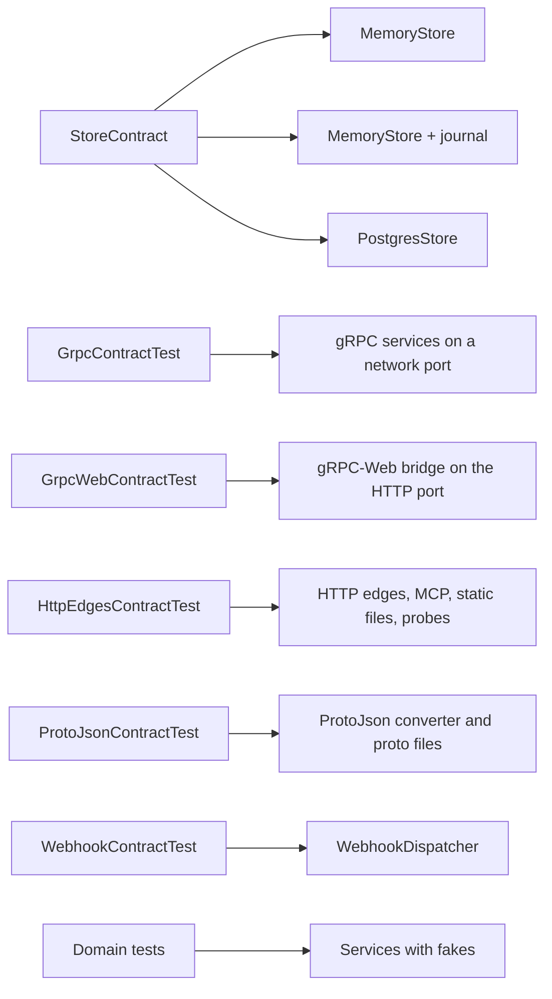

# Testing

Mayday uses contract tests at each port and boundary, and domain tests for each bounded context.



## Suites

| Suite | File | What it proves |
|---|---|---|
| `StoreContract` | `contract/StoreContract.kt` | Behavior that every storage adapter must have: monotonic numbers, optimistic concurrency, keyset pagination, filters, ordering, unique emails, atomic and concurrent run claims |
| `MemoryStoreContractTest`, `JournaledMemoryStoreContractTest`, `PostgresStoreContractTest` | `contract/StoreAdapters.kt` | Each adapter passes the contract. The journal test also checks restart recovery. |
| `GrpcContractTest` | `contract/GrpcContractTest.kt` | Native gRPC: credentials (bearer token, session cookie, none), status codes and the `mayday-error-code` trailer, `locked` = `FAILED_PRECONDITION`, incident list and patch semantics, timeline and documents, alerts, policy and change requests, directory and user RBAC, token and agent secrets shown once, delegated runs, pull agents, reports, `EventService.Subscribe`, token scopes |
| `GrpcWebContractTest` | `contract/GrpcWebContractTest.kt` | gRPC-Web bridge: message and trailer frames, both content types, errors as trailer frames, 404 for unknown methods, 400 for malformed frames, other content types not routed, streamed frames before the stream ends |
| `HttpEdgesContractTest` | `contract/HttpEdgesContractTest.kt` | HTTP error shape, dev login cookie and safe redirects, logout, token exchange, MCP JSON-RPC and RBAC, CSRF rule (`X-Requested-With`), alert intake 201/200, Alertmanager format, single-page-app fallback with security headers, health, readiness and metrics |
| `ProtoJsonContractTest` | `contract/ProtoJsonContractTest.kt` | Domain → proto → domain loses no data. Secrets (token hashes) never reach the proto. Each domain enum value has a proto value. Each proto field has a domain property with the same JSON name. Bad input is `invalid`. |
| `WebhookContractTest` | `contract/WebhookContractTest.kt` | The webhook signature and payload that push agents rely on |
| `PolicyTest`, `IncidentTest`, `AlertTest`, `IdentityTest`, `AgentTest` | `DomainTest.kt` | The rules in each product brief, including negative cases |

`ServerContract` (`contract/ServerSupport.kt`) starts the real Spring Boot application on random HTTP and gRPC ports, with memory storage, `FakeLlm` and `RecordingDispatcher`. Each subclass sets its own `spring.grpc.server.inprocess.name`.

Test doubles (`TestSupport.kt`): `FakeLlm` (scripted tool calls and answers) and `RecordingDispatcher` (records webhooks, can fail on request).

## Run

```bash
make test
```

PostgreSQL contract (any disposable database; each test uses its own schema):

```bash
docker run -d --name mayday-pg -p 5432:5432 -e POSTGRES_PASSWORD=pw postgres:18-alpine
```

```bash
MAYDAY_TEST_DATABASE_URL=postgresql://localhost:5432/postgres MAYDAY_TEST_DATABASE_USER=postgres MAYDAY_TEST_DATABASE_PASSWORD=pw ./gradlew test
```

Without `MAYDAY_TEST_DATABASE_URL`, the PostgreSQL contract is skipped.

## A new adapter

1. Implement the port.
2. Add a subclass of the contract (for example `class RedisStoreContractTest : StoreContract()`).
3. The adapter is ready when the contract passes.

A new driving adapter (for example another protocol) gets its own contract suite on top of `ServerContract`.
