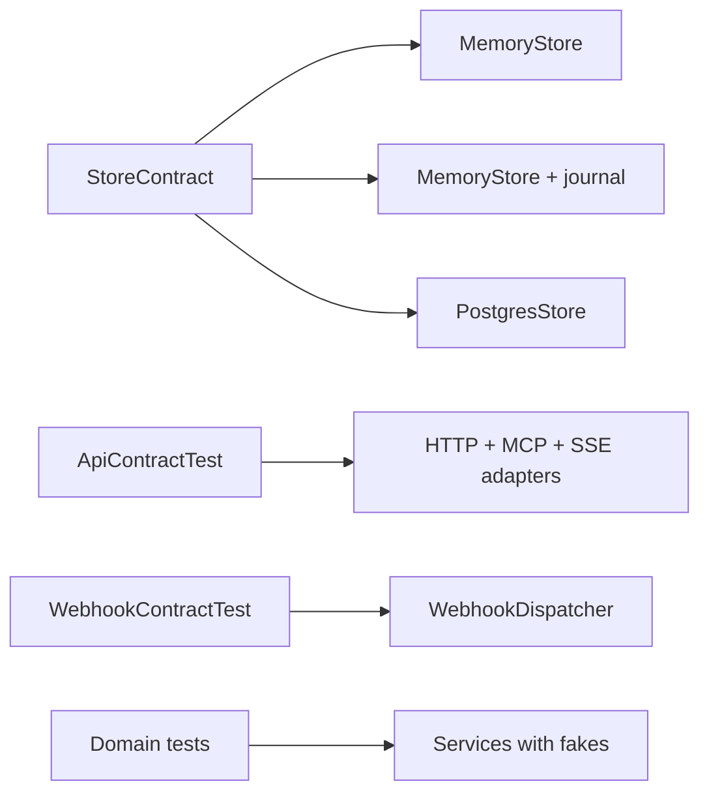

# Testing

Mayday uses contract tests at each port and boundary, and domain tests for each bounded context.



## Suites

| Suite | File | What it proves |
|---|---|---|
| `StoreContract` | `contract/StoreContract.kt` | Behavior that every storage adapter must have: monotonic numbers, optimistic concurrency, keyset pagination, filters, ordering, unique emails, atomic and concurrent run claims |
| `MemoryStoreContractTest`, `JournaledMemoryStoreContractTest`, `PostgresStoreContractTest` | `contract/StoreAdapters.kt` | Each adapter passes the contract. The journal test also checks restart recovery. |
| `ApiContractTest` | `contract/ApiContractTest.kt` | Status codes, error shape, CSRF rule, incident lifecycle, Alertmanager format, RBAC, `locked` code, MCP JSON-RPC, SSE, token exchange |
| `WebhookContractTest` | `contract/ApiContractTest.kt` | The webhook signature and payload that push agents rely on |
| `PolicyTest`, `IncidentTest`, `AlertTest`, `IdentityTest`, `AgentTest` | `DomainTest.kt` | The rules in each product brief, including negative cases |

Test doubles (`TestSupport.kt`): `FakeLlm` (scripted tool calls and answers) and `RecordingDispatcher` (records webhooks, can fail on request).

## Run

```bash
make test
```

PostgreSQL contract (any disposable database; each test uses its own schema):

```bash
docker run -d --name mayday-pg -p 5432:5432 -e POSTGRES_PASSWORD=pw postgres:18-alpine
```

```bash
MAYDAY_TEST_DATABASE_URL=postgresql://localhost:5432/postgres MAYDAY_TEST_DATABASE_USER=postgres MAYDAY_TEST_DATABASE_PASSWORD=pw ./gradlew test
```

Without `MAYDAY_TEST_DATABASE_URL`, the PostgreSQL contract is skipped.

## A new adapter

1. Implement the port.
2. Add a subclass of the contract (for example `class RedisStoreContractTest : StoreContract()`).
3. The adapter is ready when the contract passes.
