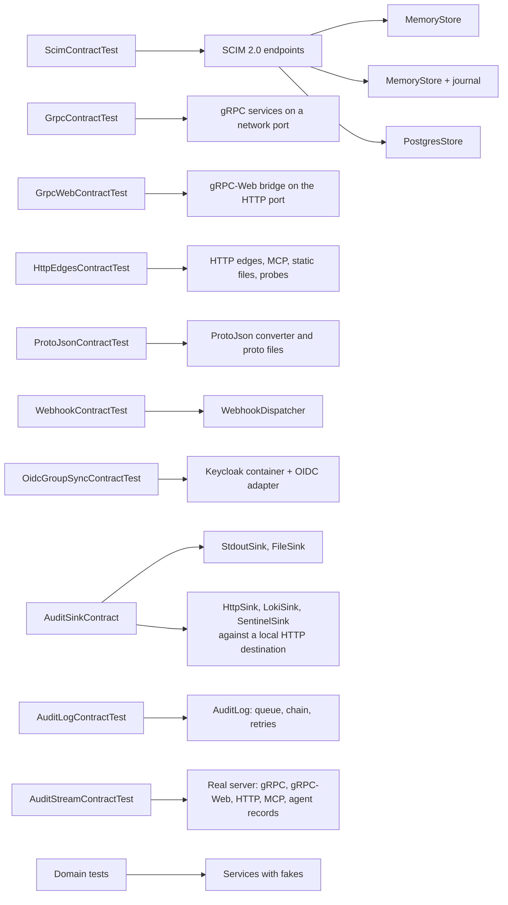

# Testing

Mayday uses contract tests at each port and boundary, and domain tests for each bounded context.



## Suites

| Suite | File | What it proves |
|---|---|---|
| `StoreContract` | `contract/StoreContract.kt` | Behavior that every storage adapter must have: monotonic numbers, optimistic concurrency, keyset pagination, filters, ordering, unique emails, atomic and concurrent run claims |
| `MemoryStoreContractTest`, `JournaledMemoryStoreContractTest`, `PostgresStoreContractTest` | `contract/StoreAdapters.kt` | Each adapter passes the contract. The journal test also checks restart recovery. |
| `GrpcContractTest` | `contract/GrpcContractTest.kt` | Native gRPC: credentials (bearer token, session cookie, none), status codes and the `mayday-error-code` trailer, `locked` = `FAILED_PRECONDITION`, incident list and patch semantics, timeline and documents, alerts, policy and change requests, directory and user RBAC, token and agent secrets shown once, delegated runs, pull agents, reports, `EventService.Subscribe`, token scopes |
| `GrpcWebContractTest` | `contract/GrpcWebContractTest.kt` | gRPC-Web bridge: message and trailer frames, both content types, errors as trailer frames, 404 for unknown methods, 400 for malformed frames, other content types not routed, streamed frames before the stream ends |
| `HttpEdgesContractTest` | `contract/HttpEdgesContractTest.kt` | HTTP error shape, dev login cookie and safe redirects, logout, token exchange, MCP JSON-RPC and RBAC, CSRF rule (`X-Requested-With`), admin scope in token exchange with `SetAgentAdmin`, alert intake 201/200, Alertmanager format, single-page-app fallback with security headers, health, readiness and metrics |
| `ProtoJsonContractTest` | `contract/ProtoJsonContractTest.kt` | Domain → proto → domain loses no data. Secrets (token hashes) never reach the proto. Each domain enum value has a proto value. Each proto field has a domain property with the same JSON name. Bad input is `invalid`. |
| `WebhookContractTest` | `contract/WebhookContractTest.kt` | The webhook signature and payload that push agents rely on |
| `ScimContractTest` | `contract/ScimContractTest.kt` | SCIM 2.0 with Entra and Okta request shapes: discovery, token rules (401 without token or with a cookie, 403 without SCIM scope or for a non-administrator), user create after a filter miss, 409 `uniqueness`, PATCH with string booleans, value objects and email paths, groups as teams, member add and remove, `excludedAttributes=members`, PUT, deprovisioning, `invalidFilter` |
| `OidcGroupSyncContractTest` | `contract/OidcGroupSyncContractTest.kt` | A real OpenID Connect provider (Keycloak in a container): access tokens with the groups claim create teams with owner groups, give roles, and follow group changes made with the Keycloak admin API, including a user without groups (Keycloak leaves the claim out) |
| `LlmProviderContractTest` (`AnthropicProviderContractTest`, `OpenAiProviderContractTest`) | `contract/LlmProviderContractTest.kt` | Both LLM adapters against a fake AI gateway: one auth header in the configured style, agent ID and fixed headers, `traceparent` on every call, token rotation, 401 → one refresh, 429 → `BudgetExhausted` with exactly one request, bounded 5xx retries, tool round trip, base URL with path prefix |
| `CredentialsContractTest` | `contract/CredentialsContractTest.kt` | OAuth 2.0 client secret and workload identity assertion grants, shared cache, single-flight and early refresh, invalidate, token file, no secrets in errors or spans |
| `TokenProxyContractTest` | `contract/TokenProxyContractTest.kt` | Token proxy sidecar: identity headers added and client credentials removed, 429 passed through once, 401 → one refresh, streaming |
| `McpGatewayContractTest` | `contract/McpGatewayContractTest.kt` | Tools gateway client: identity headers per request, static mode, 401 refresh, a grant refusal (`isError: true`) reaches the model unchanged, no decision on error messages, 429 pause without network I/O, isolation of a broken server, session expiry |
| `TelemetryContractTest` | `contract/TelemetryContractTest.kt` | OpenTelemetry adapter: nesting across suspension and dispatchers, typed attributes, errors and cancellation, W3C headers, run links |
| `LlmSettingsContractTest` | `contract/LlmSettingsContractTest.kt` | `MAYDAY_LLM_*` values win and lock their fields, generic OAuth 2.0 variables, invalid values, token parameter validation |
| `AuditLogContractTest` | `contract/AuditLogContractTest.kt` | The audit stream port: numbered and chained records, detection of changed, removed and forged records, arrival order does not matter, reads switch, a full queue reports `audit.dropped` with the exact count, a failing sink is retried without holding up the others, `emit` does not block, one chain per instance, the `audit-verify` exit codes |
| `AuditSinkContract` (`StdoutSinkContractTest`, `FileSinkContractTest`, `HttpSinkContractTest`, `LokiSinkContractTest`, `SentinelSinkContractTest`) | `contract/AuditSinkContractTest.kt` | Each sink delivers every record unchanged and in order (the chain verifies at the destination), special characters survive, a refused delivery throws; file rotation; HTTP headers, NDJSON and size limits; Loki push path, tenant, auth, low cardinality labels and nanosecond timestamps; Sentinel DCR stream URL, Entra bearer token, `TimeGenerated`, token refresh after 401 |
| `AuditStreamContractTest` | `contract/AuditStreamContractTest.kt` | The real server: denied and anonymous gRPC calls with caller, credential, source and reason; tokens issued and revoked without the secret; policy values before and after; agent admin opt-in and reset; token exchange and MCP tool calls with agent and on-behalf-of; refused hidden tools; built-in agent tool calls with the run; HTTP intake and sign-in; gRPC-Web source; spoofed source headers ignored; a client that closes its live stream is not a failure; status RPC for administrators only; the whole stream verifies |
| `PolicyReplicaTest` | `DomainTest.kt` | Two instances on one store and event bus: direct changes and approved change requests clear the settings cache of the other instance |
| `PolicyTest`, `IncidentTest`, `AlertTest`, `IdentityTest`, `AgentTest` | `DomainTest.kt` | The rules in each product brief, including negative cases |
| `RotationTest`, `OnCallTest`, `TeamMembersTest` | `OnCallTest.kt` | Rotation math (order, wrap, before start, daylight saving, windows), override precedence and cuts, schedule and override RBAC (owners vs members), integrity rules, leaving a team |
| `GroupClaimTest`, `GroupSyncTest`, `ProvisioningTest` | `GroupSyncTest.kt` | Groups claim parsing (list, nested path, string, missing claim, overage), automatic teams with filter and owner suffix, reconcile rules, manual changes locked by links, rotation exit on group loss, SCIM groups and users |
| `DelegationLimitsTest`, `UntrustedSubjectDataTest`, `AlertIngestScopeTest`, `AgentAdminExchangeTest`, `AgentAdminOptInResetTest` | `SecurityTest.kt` | Delegated run tokens have no ADMIN scope and stop when the run is finished; token exchange keeps ADMIN only with the organization setting and the user's opt-in, agents cannot opt in for the user, and turning the organization setting off clears every opt-in; alert content reaches the model only as untrusted data, apart from the task; ingest-only tokens send alerts only for the teams of their owner |
| `AgentIndependenceTest`, `BudgetExhaustedTest`, `GatewaySettingsTest` | `AgentGatewayTest.kt` | Alerts and incidents work with no agent, a hanging agent or a failing agent; 429 makes one call and pauses the agent; settings and identity headers |
| `TracingTest`, `TracingServerTest` | `TracingTest.kt` | Agent run trace tree and stored trace ID; server spans for HTTP, gRPC and gRPC-Web; no export without an endpoint |

`ServerContract` (`contract/ServerSupport.kt`) starts the real Spring Boot application on random HTTP and gRPC ports, with memory storage, `FakeLlm` and `RecordingDispatcher`. Both servers listen on `127.0.0.1` only. On a wildcard address, another local server (an IDE, a fake gateway in another test) could bind `127.0.0.1` on the same port and receive the test calls; the gRPC client then failed with "First received frame was not SETTINGS". Each subclass runs the check `no other loopback listener can take the ports of the test servers`. Test HTTP calls have a 30 s timeout, so a broken server fails a test instead of stopping the run. Each subclass sets its own `spring.grpc.server.inprocess.name`.

Test doubles (`TestSupport.kt`): `FakeLlm` (scripted tool calls and answers), `RecordingDispatcher` (records webhooks, can fail on request) and `RecordingSink` (keeps every audit batch; `ServerContract` and `Fixture` use it).

## Run

```bash
make test
```

`make test` needs a running Docker engine. `OidcGroupSyncContractTest` starts one Keycloak container. `PostgresStoreContractTest` starts one disposable PostgreSQL container per test run with [Testcontainers](https://java.testcontainers.org/). Each test uses its own schema and closes its pool. The container stops when the run ends.

| Variable | Effect |
|---|---|
| `MAYDAY_TEST_DATABASE_URL`, `MAYDAY_TEST_DATABASE_USER`, `MAYDAY_TEST_DATABASE_PASSWORD` | Use this disposable database. No container starts. |
| `MAYDAY_TEST_POSTGRES_IMAGE` | Container image (default `postgres:18-alpine`, same as `compose.yaml`) |
| `MAYDAY_TEST_KEYCLOAK_IMAGE` | Container image for `OidcGroupSyncContractTest` (default `quay.io/keycloak/keycloak:26.0.7`). The realm is `src/test/resources/keycloak/mayday-realm.json`. |

Without Docker and without `MAYDAY_TEST_DATABASE_URL`, `PostgresStoreContractTest` fails. The contract is not optional.

## A new adapter

1. Implement the port.
2. Add a subclass of the contract (for example `class RedisStoreContractTest : StoreContract()`).
3. The adapter is ready when the contract passes.

A new driving adapter (for example another protocol) gets its own contract suite on top of `ServerContract`.
